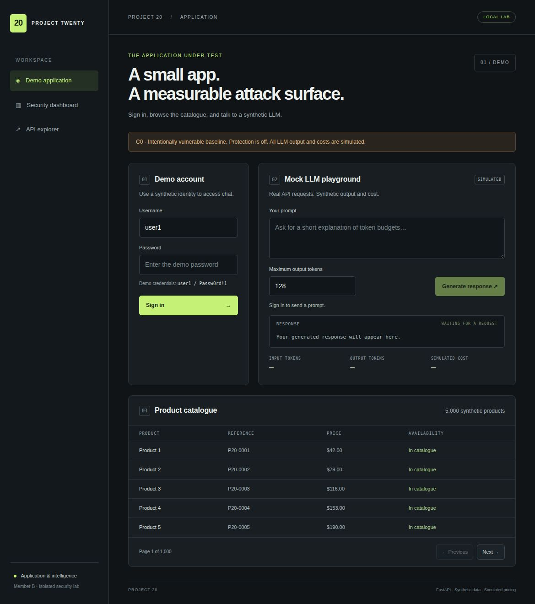
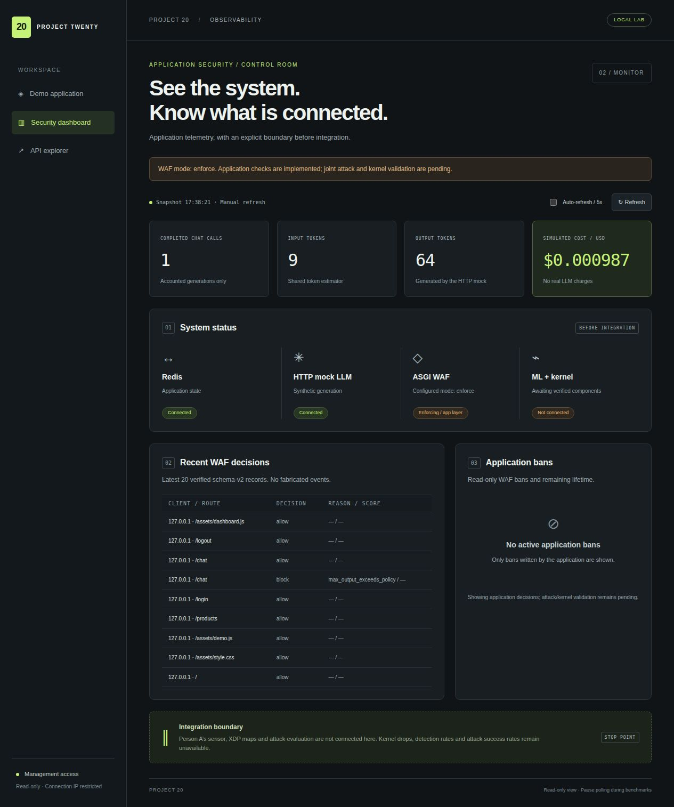
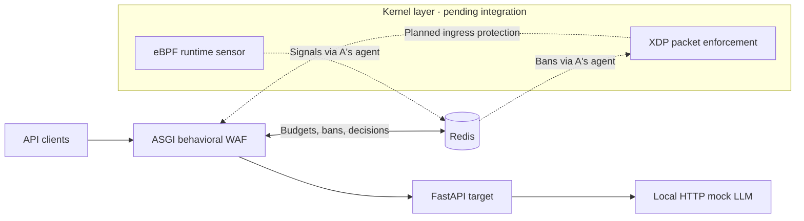

<div align="center">

# WalletGuard

### Behavioral API protection against LLM Denial-of-Wallet

A reproducible Red-vs-Blue security lab combining application budgets,
behavioral detection, and a planned Linux kernel enforcement layer.

[](requirements.txt)
[](app/main.py)
[](contract/redis_schema.md)
[](docs/evidence/application_defenses_tests.xml)
[](docs/evidence/independent_status.json)

[Overview](#overview) · [Quick start](#quick-start) · [Validation](#validation) · [Documentation](#documentation) · [Team](#team)

**Project 20 · API Security · Master SSI 2026–2027 · ISG Tunis**

</div>

## Overview

WalletGuard explores how to protect an LLM-backed API from automated abuse while
keeping normal traffic usable. The same FastAPI application runs as an intentionally
vulnerable baseline or behind an ASGI behavioral WAF, making comparisons reproducible.

| Threat | Application defense | Outcome to measure |
|---|---|---|
| Credential stuffing | Login budgets per IP and account, strikes and temporary bans | Successful malicious logins |
| Bulk API scraping | Request budgets, behavioral features and honeypot detection | Products extracted and attack success rate |
| LLM Denial-of-Wallet | Output policy, per-account token reservation and refund | Tokens consumed and simulated cost |

**This is an academic prototype for an isolated lab.** Credentials and workloads
are synthetic; the LLM is a local HTTP mock. All displayed costs are simulated.

## Current status

| Component | Status |
|---|---|
| FastAPI target, HTTP mock and usage accounting | Implemented and independently tested |
| C1 observation and C2 application defenses | Implemented and independently tested |
| Demo application and restricted dashboard | Implemented; browser-checked on desktop/mobile |
| Redis outage handling and conservative recovery | Implemented; includes disposable-Redis outage tests |
| Base IsolationForest (C3) | Uses the current agent-loop feature version and disjoint C1 run groups |
| Held-out detector evaluation | See the current feature-version-3 model evidence |
| C0/C2/C3 namespace benchmark | 81 valid agent-loop runs; benign FPR and detector limitations remain open |
| eBPF sensor, XDP and C4 integration | Pending; C4 startup is explicitly blocked |

The latest local C3 evidence includes model provenance, per-run detector results,
and C0/C2/C3 HTTP smoke runs with Member A's attacks. Earlier application evidence
remains available in the [status manifest](docs/evidence/independent_status.json).

## Preview

| Demo application · C0 baseline | Security dashboard · C2 enforcement |
|:---:|:---:|
| [](docs/evidence/demo_desktop.jpg) | [](docs/evidence/c2_dashboard.jpg) |

The demo supports login/logout, catalogue pagination and chat with token/cost
feedback. The dashboard displays real application decisions, usage and ban
lifetimes, and labels unavailable integrations explicitly.

## Architecture



Redis is the shared contract between the application and kernel tracks. The WAF
uses the source address from the ASGI connection and reserves token budget before
generation, refunding only known unused tokens. See the
[master plan](docs/MASTER_PLAN.md) and [Redis schema v2](contract/redis_schema.md).

## Quick start

### 1. Prepare the environment

Use **Linux**, **Python 3.11+**, and a reachable **Redis 7** service. From a fresh checkout:

```bash
git clone https://github.com/AhMeD-KhaTmi/walletguard.git
cd walletguard
python3.11 -m venv .venv
.venv/bin/python -m pip install -r requirements.txt
```

If the project and virtualenv already exist, use them instead of recreating them.
An existing system Redis works. If no Redis service is running, Docker is one option:

```bash
docker run -d --name p20-redis -p 127.0.0.1:6379:6379 redis:7
```

### 2. Launch the application

```bash
export REDIS_URL=redis://127.0.0.1:6379/0
.venv/bin/python scripts/run_demo.py --mode enforce
```

This starts the **C2 application defenses** and the HTTP mock on loopback. To
explore the vulnerable baseline, use `--mode off`; for data collection, use
`--mode observe`. The launcher keeps ML and kernel signals disabled, never resets
data automatically, and stops both owned services with **Ctrl+C**.

### 3. Open the workspace

| View | Local URL |
|---|---|
| Demo application | [localhost:8000](http://127.0.0.1:8000/) |
| Security dashboard | [localhost:8000/dashboard](http://127.0.0.1:8000/dashboard) |
| Interactive API docs | [localhost:8000/docs](http://127.0.0.1:8000/docs) |
| Dependency health | [localhost:8000/health](http://127.0.0.1:8000/health) |

Synthetic demo login: **`user1` / `Passw0rd!1`**. Accounts `user1` through `user50`
use matching `Passw0rd!<n>` passwords. The mock uses port **8001**; clients call
the target API on port **8000**. No paid LLM service or API key is required.

<details>
<summary><strong>Manual services and VM deployment</strong></summary>

Start the mock in one terminal:

```bash
.venv/bin/python -m uvicorn app.llm_service:app --host 127.0.0.1 --port 8001
```

Start the C2 target in another:

```bash
REDIS_URL=redis://127.0.0.1:6379/0 LLM_BASE_URL=http://127.0.0.1:8001 \
WAF_MODE=enforce WAF_BUCKETS=1 WAF_HONEYPOT=1 WAF_ML=0 WAF_EBPF_SIGNALS=0 \
.venv/bin/python -m uvicorn app.main:app --host 127.0.0.1 --port 8000 --no-proxy-headers
```

Only the API should bind to `0.0.0.0` when namespace clients need access inside
the isolated Linux VM. Keep the mock on loopback and retain `--no-proxy-headers`:
forwarded headers must not replace the true source IP. Use one Uvicorn worker.
`LLM_TIMEOUT_S` defaults to 10 seconds. Do not replace an unrelated running service.

</details>

## Experiment configurations

| Config | Purpose | Readiness |
|---|---|---|
| **C0** | Vulnerable baseline; `WAF_MODE=off` | Available |
| **C1** | Observe only; `WAF_MODE=observe WAF_ML=0` | Available |
| **C2** | Enforce buckets + honeypot; ML off | Available |
| **C3** | C2 + base IsolationForest | Available locally with the trained model |
| **C4** | C3 + kernel signals, augmented model and XDP | Integration pending |

For C2–C4, keep `WAF_BUCKETS=1 WAF_HONEYPOT=1`; C3 adds `WAF_ML=1`, and C4 adds
`WAF_EBPF_SIGNALS=1` plus A's running components. Existing flag names and config
meanings are fixed in the [master plan](docs/MASTER_PLAN.md). Health reports actual
application control flags; it does not certify XDP readiness.

## Validation

With Redis reachable, run these **sequentially**:

```bash
.venv/bin/python -m pytest -q
.venv/bin/python scripts/check_application.py
```

The full suite also requires `redis-server` on PATH to launch disposable outage-test
instances. Tests use and flush **scratch database 15**. Do not share that database
with valuable data or a concurrent test/preview. Outage tests stop only their own
Redis process. HTTP developer probes own their API/mock processes and clean up afterward.

| Saved evidence | Scope |
|---|---|
| [64-test report](docs/evidence/application_defenses_tests.xml) | Baseline, UI access, budgets, refunds, bans, observation, recovery and ML tooling |
| [12 HTTP checks](docs/evidence/application_http_checks.json) | Real HTTP C0/C1/C2 development scenarios |
| [C2 process evidence](docs/evidence/c2_local_evidence.json) | Bounded local timing/outage records |
| [Status + source hashes](docs/evidence/independent_status.json) | Provenance and pending dependencies |
| [C3 base-model evidence](docs/evidence/c3_base_model.json) | Historical version-2 dataset hashes and detector results |
| [C2/C3 benchmark](docs/C23_BENCHMARK_RESULTS.md) | 54 matched namespace runs, attack outcomes, benign latency and scoring overhead |
| [Current agent benchmark](docs/PROFESSOR_BENCHMARK_RESULTS.md) | 81 matched C0/C2/C3 runs, exact token evidence, baseline latency differences and open acceptance issues |

These checks do not replace A's Locust workloads, realistic benign false-positive
evaluation, joint IT-1–6 or final repeated ASR/latency/resource measurements.

### Reset before a measured run

Stop traffic and experiment processes, then select the intended Redis database:

```bash
REDIS_URL=redis://127.0.0.1:6379/0 bash scripts/reset_state.sh
```

The helper clears documented runtime keys, **including sessions**, while preserving
the allowlist, schema version and unrelated keys. It does not reset process-local
history or kernel maps/counters. Restart/reconcile those separately. Do not reset
state while an experiment is running. Pause dashboard polling during benchmarks.

## ML workflow

Current training uses freshly collected feature-version-3 agent traffic, with
separate fitting, calibration and held-out runs. The earlier traffic handoff
contains version-2 single-call data and is preserved for historical comparison.
The [professor update](docs/PROFESSOR_UPDATE.md) records the changed runtime.
The [81-run benchmark](docs/PROFESSOR_BENCHMARK_RESULTS.md) records its measured
behavior. Current benign enforcement FPR is 2.350% in C2 and 2.271% in C3;
budget calibration and detector improvements remain open before final acceptance.

After collecting the current C1 data, the training inputs are local generated files:

```bash
.venv/bin/python ml/train.py --csv ml/data/professor-agent3/benign.csv \
  --splits ml/data/professor-agent3/splits.json
.venv/bin/python ml/evaluate.py --model ml/model_base.joblib \
  --csv ml/data/professor-agent3/test.csv --splits ml/data/professor-agent3/splits.json \
  --output ml/data/professor-agent3/evaluation.json
```

Start the C3 demo with Redis reachable:

```bash
.venv/bin/python scripts/run_demo.py --mode enforce --model ml/model_base.joblib
```

Open the app at `http://127.0.0.1:8000/` and the management dashboard at
`http://127.0.0.1:8000/dashboard`. The model manifest records feature order and
units, threshold, seed, dataset and split hashes, dependency versions and source
provenance. The model binary and input CSVs are generated locally. Use the
[professor update](docs/PROFESSOR_UPDATE.md) for current per-run detector results and
keep the held-out set separate from any future tuning. The augmented model awaits
real sensor data.

For a fresh clone, the frozen comparison model is also included under
[`ml/artifacts/`](ml/artifacts/README.md), with its manifest and SHA-256. Start C3
with `--model ml/artifacts/model_base_agent_v3.joblib`. Its recorded scikit-learn
version must match; preserve this binary while calibrating candidate models.

The [earlier C2/C3 results](docs/C23_BENCHMARK_RESULTS.md) describe the single-call runtime. The [benchmark handoff](docs/C3_BENCHMARK_HANDOFF.md) records how application
timings are captured and summarized.

<details>
<summary><strong>Operational boundaries and failure behavior</strong></summary>

- **Dashboard:** HTML/data/evidence routes require loopback or an exact management
  allowlist IP. Demo accounts do not grant dashboard access. Review this boundary
  before adding a reverse proxy. Dashboard data is read-only; optional 5s polling
  pauses when hidden. Ban displays scan at most 200 keys and label truncation.
- **Sessions:** bearer tokens remain in page memory; reloading requires signing
  in again. Logout revokes the server session. No localStorage/sessionStorage
  tokens are used. Content is rendered as text; pages use CSP and no-store caching.
- **Accounting:** displayed usage counts completed accounted chat generations,
  not every HTTP request. Timeouts may leave generation uncertain; no automatic
  generation retry or blind reservation refund occurs.
- **Redis outage:** local one-worker budgets retain known balances; unknown
  balances start empty and refill. Cached identities expire at their original
  deadline. Admitted new session writes return 503. Bans retain expiry; reconnect
  keeps the smaller local/Redis balance rather than granting a new burst.
- **Local evidence:** completed usage during store errors is retained separately
  with `X-Usage-Store: local_uncertain_redis_commit`. Export restricted
  `/dashboard/evidence` before restarting; uncertain Redis commits must not be
  automatically double-added to local totals.
- **Bounds:** snapshots default to 4,096 identities, feature history to 10,000
  events/IP and telemetry to 10,000 records. Saturation/evictions are observable.
  Restart or identity churn can lose local context; socket timeouts affect network
  failure latency. These are prototype limits, not distributed guarantees.
- **Detection:** ML-only anomalies do not auto-ban; repeated anomalies need budget
  corroboration. Production ML and kernel measurements remain pending. Unknown
  telemetry is unavailable, not a fabricated zero.

Never commit real credentials, API keys, bearer sessions, private captures or prompts.

</details>

## Repository map

```text
app/        FastAPI target, HTTP mock and visual interface       [B]
waf/        ASGI policy, Lua budgets, bans and feature extraction [B]
ml/         Export, grouped training and detector evaluation     [B]
locust/     Attack/benign workloads — pending handoff             [A]
ebpf/       Sensor and XDP enforcement — pending handoff          [A]
eval/       Evaluation harness and objective metrics              [A]
contract/   API and Redis contracts, bridge helpers               [shared]
common/     Dependency-free token estimation                     [shared]
scripts/    Local launch, reset and development checks            [shared]
tests/      Independent application regression tests
docs/       Plans, handoffs, work journal and saved evidence       [shared]
```

## Documentation

| Start here | Purpose |
|---|---|
| [Master plan](docs/MASTER_PLAN.md) | Agreed architecture, milestones and acceptance gates |
| [Member A agent guide](docs/MEMBER_A_AGENT_HANDOFF.md) | Exact reading order, first deliverables and branch/PR workflow |
| [Member A plan](docs/member_A_plan.md) | Attack & Kernel work and current handoff corrections |
| [Member B plan](member_B_plan.md) | Application & Intelligence work and progress checklist |
| [API handoff](contract/api_handoff.md) · [OpenAPI](contract/openapi.json) | Routes, synthetic accounts, usage and failure semantics |
| [Redis schema](contract/redis_schema.md) | Versioned keys, fields, units and lifetimes |
| [Project journal](docs/PROJECT_JOURNAL.md) | Decisions, completed work, checks and unresolved dependencies |
| [Agent instructions](AGENTS.md) | Repository conventions and ownership boundaries |

## Team

| Member | Track | Ownership | Contact |
|---|---|---|---|
| [AhMeD-KhaTmi](https://github.com/AhMeD-KhaTmi) · Member B | Application & Intelligence | API, mock LLM, WAF, ML tooling and dashboard | [GitHub](https://github.com/AhMeD-KhaTmi) |
| Member A | Attack & Kernel | Traffic scenarios, evaluation, eBPF sensor and XDP | [amantounsi@gmail.com](mailto:amantounsi@gmail.com) |

Both members share contracts, integration tests, final measurements and presentation.
Work on separate branches and submit pull requests into `main`; review and test
the other track in an isolated checkout before merging. The next handoff is A's
attack scripts, realistic multi-IP benign traffic and run labels.
