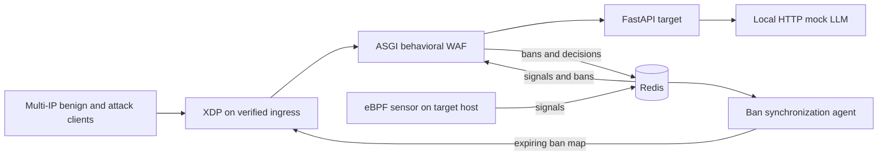

# Project 20 — coordinated execution plan

> Current model update, 2026-11-18: directional-volume IsolationForest passed
> fresh offline gates (99.01% recall / 99.58% precision; 5.77% benign flags) and
> an independent 18-run live confirmation (966 benign C3 requests, zero
> denials/unknowns/bans). [Results](DETECTOR_VOLUME_RESULTS.md). The first live grid's shutdown
> failure is preserved; confirmation uses an explicitly recorded lifecycle driver.
> Current artifact: `ml/artifacts/model_base_volume_v1.joblib`; original frozen
> model remains available. Validated budgets/batching and Redis schema2 stay fixed.

Version: 1.5 · 2026-11-18 · Owners: Member B (user) and Member A.

## 1. How to use this plan

This is the current execution plan for both tracks. It consolidates the project
concept, both original member plans and the findings in `PROJECT_JOURNAL.md`.
The user authorized the planning decisions below on 2026-11-16. Older plans remain
useful background and starter examples; where they conflict, follow this plan and
`../contract/redis_schema.md`. Starter examples are not completed implementations.

Read `../AGENTS.md` and `PROJECT_JOURNAL.md` before implementation. Update the
journal after each meaningful work session. Record evidence before checking off
a milestone. Planning decisions are settled here; code findings remain open until
implemented and tested. See the journal for current verification status; individual
baseline checks do not imply the joint attack/kernel gates are complete.

Current progress: C0/C1/C2 application checks and outage handling are implemented.
The agent-loop revision uses fresh feature-version-3 C1 data and model training.
See [the professor update](PROFESSOR_UPDATE.md) for current verification.
The [current agent benchmark](PROFESSOR_BENCHMARK_RESULTS.md) contains 81 valid
C0/C2/C3 runs. Its initial benign FPR and zero-ban targets were unmet. Preserve
those frozen findings. Fresh [budget calibration](BUDGET_CALIBRATION.md) and
[36 independent runs](BUDGET_VALIDATION_RESULTS.md) now verify the calibrated
40,000-token capacity / 2,400-token/s policy: zero observed benign policy denials
and zero bans in C2/C3. Two client-shutdown interruptions remain unknown; their
worst-case denial rate is still below 1%. The original base detector's very low
recall and scoring overhead were addressed in separately validated studies;
see [the detector results](DETECTOR_VOLUME_RESULTS.md). Real C4 acceptance remains open. No budget values
were selected using the frozen campaign or the new validation outcomes.
The earlier [54-run benchmark](C23_BENCHMARK_RESULTS.md) remains historical.
The full C0–C4 comparison awaits the real kernel integration and joint acceptance.

The professor's six proposals are approved with conditions as reported in the
user-supplied [feedback comparison](masterplan_vs_professor_diff.pdf). This version
adopts those conditions. The PDF's implementation suggestions guide our choices.
Use a simulated agent loop, exact synthetic token counts, configurable latency,
Ubuntu 22.04/24.04 with kernel >=5.15 and BTF, and documented enforcement fallbacks.
Report ASR with benign enforcement FPR and p50/p95 overhead against matched C0.
An OpenAI/Ollama-compatible live demonstration is optional. Load campaigns use
the local synthetic backend and require no paid credentials.

## 2. Objective and scope

Build one API, demonstrate credential stuffing, bulk scraping and LLM cost abuse
against its vulnerable mode, then quantify how the application and kernel defenses
reduce those outcomes. Report legitimate-user latency and false positives along
with security results. A control need not block every malicious request to be
useful; report residual abuse honestly.

Included: FastAPI, asynchronous ASGI WAF, Redis atomic budgets, honeypot, strikes,
IsolationForest, Locust, Linux runtime sensor, XDP and a reproducible evaluation.
Included agent behavior is a bounded simulated catalogue-tool loop with growing
context and repeated local HTTP calls. Excluded: real leaked credentials, paid LLM calls,
distributed deployment and claims of production-grade protection.

## 3. Architecture and fixed design decisions

### 3.1 Deployment and identity

- Use one Linux target VM and one Uvicorn worker for the measured prototype.
  Target Ubuntu 22.04 or 24.04 LTS, kernel >=5.15 and
  `/sys/kernel/btf/vmlinux`. Save `scripts/check_environment.py` results with G0.
  Redis may run in Docker; run the API directly on the VM to avoid source-IP NAT.
- B exposes the existing mock through a separate local HTTP process, planned as
  `app/llm_service.py`, with a fixed port configured through application settings.
  The API calls it using an asynchronous HTTP client. Keep the existing estimator,
  usage semantics, output hard cap and simulated pricing consistent.
- `/chat` defaults to three simulated agent steps and accepts `agent_steps`
  from 1 to 8 in every config. Each step calls `/complete`, records its usage,
  appends the generated text and deterministic catalogue observation to context,
  and closes its backend HTTP connection so `connect` activity varies with steps.
  Response usage and headers aggregate all steps. Partial confirmed usage is
  recorded on failure. A timeout retains the full reservation conservatively.
- Tokenizer `synthetic-whitespace-v1` counts whitespace-delimited words exactly,
  including zero for empty input. `common/tokens.py::estimate_tokens` remains
  the shared counting entry point. Generated words match reported output counts.
  `MOCK_TOKENS_PER_S`, `MOCK_BASE_MS`, `MOCK_JITTER_MS`, `MOCK_DELAY_CAP_S`
  and `MOCK_SEED` define deterministic mock latency and are saved in run manifests.
- Use this same backend, code revision, dataset and application behavior in C0–C4.
  Make this change before collecting the final baseline; earlier starter runs
  are development checks, not comparable final results.
- A monitors the API process's connection to that mock. The local mock may use
  loopback: the restriction on loopback applies to attacker-facing XDP tests,
  not to observing a local backend connection with runtime probes.
- A creates distinct namespace/veth IPv4 clients. Verify their addresses in ASGI
  and kernel observations before testing protection. Never trust forwarded headers.
- Reserve separate management, benign and attacker addresses, and separate account
  pools. Record all roles per run. Only management addresses enter the allowlist.

### 3.2 Configurations — meanings and flag names unchanged

| Config | WAF_MODE | WAF_BUCKETS | WAF_HONEYPOT | WAF_ML | WAF_EBPF_SIGNALS | Kernel enforcement |
|---|---|---|---|---|---|---|
| C0 | off | 0 | 0 | 0 | 0 | Off; XDP detached |
| C1 | observe | 1 | 1 | 0 | 0 normally | Off; XDP detached |
| C2 | enforce | 1 | 1 | 0 | 0 | Off; XDP detached |
| C3 | enforce | 1 | 1 | 1 | 0 | Off; XDP detached |
| C4 | enforce | 1 | 1 | 1 | 1 | Sensor and agent with verified enforcement mode |

C1 may set `WAF_EBPF_SIGNALS=1` with the sensor running and XDP detached to collect
real augmented training features. It remains observe-only with ML disabled; this
is a data-collection variant, not a sixth evaluation configuration. Record the flag.
Optional sensor-only calibration runs must be identified separately from C0–C4.

Require explicit environment values for each run; do not inherit shell defaults.
Reject unsupported configuration values. A requested missing/incompatible ML model
fails readiness/startup; it must not silently downgrade C3/C4 to C2.

For C4, attempt native XDP, then generic/skb XDP. If XDP is unusable, use a
verified tc/nftables consumer of the same Redis ban records, or record WAF
enforcement with the sensor present. Record the backend, interface, attach mode
and fallback reason. Only claim packet drops where that backend produced evidence.
Never equate a WAF-only fallback with a working kernel drop path.

### 3.3 WAF policy

Keep settings in `waf/config.py::Config`, then freeze them before evaluation.
The token allowance below is the independently fitted and validated lab policy;
other entries retain the initial settings. None is a universal optimal threshold.

| Control | Initial policy |
|---|---|
| All requests per IP | Capacity 30, refill 2/s |
| Login per IP | Capacity 5, refill 5/minute |
| Login per account | Capacity 5, refill 5/15 minutes |
| Chat requests per account | Capacity 10, refill 0.5/s |
| LLM tokens per account | Capacity 40,000, refill 2,400/s; [calibration and status](BUDGET_CALIBRATION.md) |
| Hardened output cap | 1,024 tokens; baseline mock hard cap remains 32,000 |
| Request body limit in WAF | 1,000,000 bytes |
| Strikes / ban | 5 qualifying strikes in a fixed 300s window; ban 600s |
| Honeypots | `/admin-backup`, `/internal/export`, `/.env`; also match trailing slash and descendants separated by `/`, not arbitrary suffixes |
| Sensor freshness | IP updated within 3s; host updated within 5s |

Decision flow: resolve source identity and management exemption; check active ban;
read a bounded body; validate policy inputs; detect honeypot; compute the needed
features and policy verdicts; apply request/account/token limits; forward only
allowed requests; reconcile accounting; record the decision.

- C0 has no WAF controls. Invalid-input correctness fixes apply to the same API
  in every config: output count is a positive integer, never a negative budget
  cost. Preserve the baseline's deliberately unrestricted valid traffic.
- Honeypot access immediately bans non-allowlisted clients, returning the planned
  decoy 404; later requests see the active ban. Budget exhaustion returns 429
  with a meaningful `Retry-After`. Repeated budget denials reach the strike limit.
- ML alone records anomalous strikes and allows the request. An anomaly ban needs
  five anomalies in the strike window AND corroboration: a real recent budget
  denial for that IP or fresh per-IP connection count above a configured threshold.
  Start the latter at 100 accepted connections/10s; freeze after calibration.
  Host-wide egress and unexpected-exec alerts are context, not proof against an IP.
- Keep budget and anomaly strike counts distinguishable in private state. The
  existing aggregate helpers may be refactored; shared ban reasons remain unchanged.
- C3 can detect/ban continuing anomalous behavior following a recent budget denial;
  C4 can also use fresh kernel corroboration. Measure whether ML adds value. Do not
  tune against final test data or promise C3 will outperform C2 on every workload.
- Reserve the whole agent task atomically before its first call, including
  every repeated input, output and tool-context marker. With S steps, P input
  tokens, O capped output tokens and G = O+9 context-growth tokens, the bound is
  `S*(P+O) + G*S*(S-1)/2`, implemented only in `common/agent.py`.
  Preserve reservation ownership through every verdict. Refund unconsumed tokens
  on rejection/cancellation/errors where generation did not occur. If usage is
  uncertain after generation started, retain the reservation conservatively and
  mark accounting uncertain; never refund merely because headers were absent.
- Actual generated usage is `llm_tokens_charged`; reservation and refund are
  separately observable. Impossible costs above capacity get a policy rejection,
  not a misleading retry time. Validate all bucket parameters.
- Body handling, model scoring and telemetry must not introduce blocking I/O in
  the request path. Use bounded buffers and offload model work where necessary.

### 3.4 Observe mode and feature history

C1 forwards every request the API would normally receive. It writes no real bans,
consumes no enforcement budgets and changes no enforcement strikes. Compute
`would_*` verdicts using separate private shadow state. Always collect intended
request features, even when a shadow check would reject early. Management requests
are explicitly excluded from the dataset rather than silently counted as benign.

Use timestamped time-window state that can distinguish high rates beyond 100
requests. If a safety bound is reached, record saturation; do not call a truncated
count exact. The shared tokenizer supplies prompt counts. Feature version 3 adds
`agent_steps` and `task_token_budget`. Version-2 datasets/models and single-call
measurements are historical evidence and require fresh collection and training
for this runtime. Reject incompatible model manifests at startup.
Record missing/stale sensor state separately from real measured zero.

### 3.5 Failure and recovery

- If the sensor/agent stops, WAF budgets, honeypot and bans continue. Stale eBPF
  features are marked unavailable. Use the base model as an explicitly logged
  degraded path; C4 benchmark readiness requires fresh real signals.
- On Redis failure, use process-local monotonic-clock buckets with locks and the
  same policy semantics. All fallback math lives inside `waf/buckets.py`; this is
  the approved exception to the normal Redis-Lua-only rule. Use one worker and
  disclose that this fallback has no cross-worker guarantees.
- Cache established sessions locally only until their original Redis expiry;
  never extend authentication. Previously cached users can keep using the mock
  under local budgets. New successful logins requiring session persistence return
  503 while Redis is unavailable. Invalid credentials retain normal API behavior.
- Retain known allowlist and active-ban snapshots only for their valid lifetime;
  local honeypot/strike bans are bounded, expire, and are reconciled on recovery.
  No Redis-backed cross-layer ban delivery is promised during an outage.
- Maintain bounded outage usage/decision records as explicitly degraded local
  artifacts; do not silently double-add them into Redis after reconnecting. Report
  Redis and outage totals separately and account for dropped telemetry.
- Recover buckets conservatively through an atomic reconciliation operation:
  refill each representation to the same instant, then retain the smaller balance.
  Unknown prior balances start empty and refill normally. Redis reconnection must
  not grant a new full burst. Test restart and lost-local-state limits explicitly.
- A stores monotonic expirations in kernel map values from remaining Redis TTL.
  XDP checks expiry even if the agent dies. Reconcile at startup, on pub/sub, and
  every 2s; remove allowlisted entries, expired bans and deleted bans. Detach only
  the program owned by this run during normal shutdown. Report actual attach mode.
- An outage run is a separate resilience experiment; do not mix its metrics into
  normal C0–C4 performance summaries.

## 4. Ownership, deliverables and handoffs

### Visual interface — Member B

Build a small interface served by the existing FastAPI app, with local HTML/CSS/JS
assets and no separate frontend build requirement. Existing API routes and their
measurement semantics remain available to Person A's scripts.

| Page | Contents | Delivery point |
|---|---|---|
| Demo app `/` | Login/logout, paginated products, chat, per-response input/output tokens and clearly labeled simulated cost | After baseline verification, before C2 demo |
| Management dashboard `/dashboard` | Effective configuration, dependency/model status, usage totals, recent decisions, active bans/TTL, anomaly scores and fresh sensor/XDP telemetry | Basic status after B1; connect each real control during B2–B4/C4 |

Dashboard reads are read-only and separate from measured application traffic. Use
a management source-IP boundary checked from ASGI scope (loopback locally, explicit
management allowlist on the VM), including dashboard data endpoints. Do not trust
forwarded headers. Serve no session secrets, full prompts or passwords in telemetry.
No reset, ban or configuration-changing dashboard buttons in the initial scope.
Do not create an attacker control panel or browser attack generator.

Use real backend data, bounded polling and bounded history. Show unavailable/stale
data explicitly; never display invented zeroes or enabled ML/XDP merely because
a flag is set. Label C0 as intentionally vulnerable and costs as simulated.
Keep user-entered/rendered content safe from HTML injection. Test API actions,
dashboard access restrictions, loading/error/empty states and the visual interface
in a browser. Retain screenshots with development evidence. Pause dashboard
polling during measured runs, or use a separately identified management process
and report its load. A dashboard is visibility, not the benchmark source of truth.

### Track ownership

| Area | Owner | Deliverable | Needed by |
|---|---|---|---|
| API + HTTP mock | B | Working baseline, usage accounting, exported OpenAPI, demo accounts | A1 and IT-3 |
| Buckets, honeypot, bans | B | Tested C2 and documented decision behavior | A's attack/evaluation runs |
| Features and ML | B | Reproducible base/augmented training, model manifests and evaluation | C3/C4 |
| Traffic and labels | A | Three attacks, decoy/churn probes, benign generator, per-run identity lists | B2–B4 |
| Kernel layer | A | Scoped sensor, expiring XDP map, synchronization and per-IP telemetry | C4 and IT-1–5 |
| Evaluation implementation | A | Verified config orchestration, objective logs, result aggregation | Final evidence |
| Latency, FPR, ML measurements | B | Measurement logic/data specification and measured artifacts | A's merged results |
| Contracts, reset and integration | Joint | Versioned schemas, mocks, IT-1–6, run protocol | Both tracks |

The assistant working for B does not silently edit `ebpf/`, `locust/` or `eval/`.
Give A the required changes through the shared plan; B's measurement helpers can
live under `scripts/` and `ml/`. A creates/updates `eval/schema.md` from section 7.
No messages to A are sent automatically by this plan.

## 5. Milestones and working schedule

Use relative working days, not calendar promises. Parallel tasks below describe
the two human tracks, not authorization to spawn assistant agents. Allow roughly
17 person-days each across four weeks; acceptance gates take precedence over dates.

| Gate | Target | B work | A work | Evidence to pass |
|---|---|---|---|---|
| G0: environment + contracts | Days 1–2 | Check venv/Redis; API smoke test; contract/OpenAPI | Kernel hello-world; namespaces; BCC interpreter check | Distinct real IPs reach API; contract v2 understood; environment recorded |
| G1: credible baseline | Days 2–4 | HTTP mock, shared validation/accounting, tests | Seeded datasets, attacks and benign traffic, objective logging | C0 shows all three abuse objectives; complete usage and client logs |
| G2: deterministic C2 | Days 4–7 | Correct buckets/refunds; honeypot; strikes; observe mode; degradation tests | Replay attacks; verify denied outcomes; sensor development | C0/C2 comparison, ban TTL/pubsub, no negative/reservation leakage, benign smoke run |
| G3: C1 data and C3 | Days 7–11 | Feature pipeline, base model, held-out metrics | Multi-IP labeled runs; real sensor signals and attribution | Data manifest; repeatable training; independent test metrics; ML policy tests |
| G4: full C4 integration | Days 11–14 | Sensor features, augmented model, failure/recovery tests | XDP expiry, map sync, per-IP counters, egress calibration | All IT-1–6 evidence; no fabricated sensor fields |
| G5: evaluation + defense | Days 15–17 | Latency/FPR/overhead results; own slides | ASR/time-to-ban/cost results; own slides | Three repetitions per evaluated workload/config; merged results; two rehearsals and backup recording |

For each gate: update journal, retain raw artifacts, document startup/test commands,
and cross-review the other track's handoff. Do not mark G1/G2/G4 done using unit
tests alone. Missing A scripts may allow B unit work, but block attack-validation claims.

### Current next work — independent calibration and the kernel handoff

1. B preserves the current 81-run evidence and shares the professor update, source
   snapshot, model manifest and revised plans with A.
2. B gathers new calibration traffic for the legitimate multi-step agent, adjusts
   budgets/strike behavior only from calibration evidence, and retests independently.
   Maintain the qualified volume detector and validated batching; preserve independent test groups.
3. A delivers the scoped sensor and tested enforcement backend with actual mode,
   freshness, expiry, allowlist and per-IP telemetry evidence.
4. Both integrate real signals, collect augmented data, complete IT-1–IT-6 and run
   the final matched C0–C4 comparison. No final acceptance is claimed yet.

### Original B0/B1 starting sequence — completed reference

1. Read instructions, this plan and journal; inventory files and environment.
2. Verify Python/venv, dependencies and Redis connectivity without replacing an
   existing service blindly. Run existing tests only against scratch DB 15.
3. Make reset report failures; run it before manual experiments and preserve the
   management allowlist. Document service ownership and cleanup.
4. Smoke-test login, products, chat, usage and OpenAPI in baseline mode.
5. Implement the HTTP mock and accounting/validation correctness before recording
   final baseline evidence. Keep WAF policy enforcement out of C0.
6. Export `contract/openapi.json`; record baseline status and handoffs in the journal.

## 6. ML and sensor data protocol

1. Collect C1 benign-only runs across multiple source IPs/accounts and varied
   prompts, payload sizes, rates and normal bursts. Keep failures representative.
2. Use separate run/session groups for training, threshold calibration and final
   test. Preserve a dataset manifest with hashes, roles, seeds and collection flags.
3. Train IsolationForest on benign training data, seed 42, initially 100 trees.
   Calibrate a lower-tail `score_samples` threshold on benign calibration runs;
   lower scores mean more anomalous. Start at the 0.5th percentile, then freeze.
4. Evaluate detector precision/recall/FPR separately from actual WAF enforcement
   FPR. Report denominators and both base and augmented model scoring times.
5. Train the augmented model only on runs with real measured, fresh sensor data.
   Availability indicators form part of the versioned feature manifest. Do not
   substitute fake signals in final training or evaluation.
6. Save model, feature order/units, threshold, seed, dataset hash, dependency versions
   and code revision together. Reject mismatched models at readiness.
7. On any model change, rerun the same preserved evaluation datasets and report
   before/after precision, recall, FPR and scoring cost. No final-test retuning.

A measures accepted connections, SYNs, failed connections and bytes independently;
accepted connections are not SYN counts. Scope observations to the target service
and process/cgroup, and verify accepted socket/source-IP attribution on the VM.
Keep-alive is enabled normally; use a dedicated churn probe to test connection signals.
Sensor syscall representatives are app-scoped `connect` and `execve`. Track
unexpected process execution and backend destinations with process attribution.
The simulated tool loop uses local data and never executes prompt-provided code.

## 7. Evaluation specification

### 7.1 Per-request truth and success

Client records are the denominator source in every config, including C0 and XDP
timeouts. Separate setup traffic from measured malicious requests. Record intent
before transmission; distinguish scheduled-but-unsent actions from actual attempts.
Include sent attempts with timeouts/errors, and retain whether bytes reached a socket
when observable. Never equate Locust expected-response success with attack success.

| Workload | Malicious success | Additional outcome |
|---|---|---|
| Credential stuffing | Attempt returns a valid demo login token | Unique accounts compromised; attempted/valid credential mix |
| Scraping | Attempt returns the requested product data | Unique products/pages harvested and extraction rate |
| DoW | Measured malicious chat generates nonzero accounted usage | Actual tokens, simulated cost and cost per minute |

`ASR = successful malicious attempts / total measured malicious attempts` per attack.
Define a fixed client timeout in the run manifest and retain unknown outcomes when
the server may have generated tokens despite a client timeout; reconcile against
authoritative mock usage. Report unresolved counts rather than guessing success.
Baseline stuffing need not have high absolute ASR because most credentials are wrong.

Include over-cap DoW and repeated under-cap DoW separately. Pre-authenticate chat
users in a setup phase at a legitimate rate, then begin the measured phase with
fresh documented WAF policy state while preserving sessions. Charge setup traffic
separately. Also run a combined end-to-end attack without special setup as a distinct
workload. Honeypot and connection-churn probes are explicit integration workloads.

### 7.2 Run procedure

1. Save run ID, config, workload, repetition, seed, duration, rate/concurrency,
   timeout, source/account roles, policy/model/dataset hashes, revision, environment,
   interface/attach mode, flags and start time. Use a new output directory.
2. Stop traffic; stop/reset agents; detach prior run's XDP. Clear `p20:` runtime
   state including evaluation counters/streams and local histories, while preserving
   management allowlist and schema version. Never flush unrelated Redis data.
3. Start Redis, mock and configured API. For C4 start sensor and agent/XDP. Verify
   effective flags/model, clock alignment, empty maps/counters and fresh signals.
4. Perform setup/warm-up separately, then reset measured counters/policy state as
   defined above. Keep setup sessions and label them. Start concurrent event capture
   before measured traffic. Run fixed attack, benign-only and mixed workloads separately.
5. Stop/drain traffic, retain raw client/server/kernel evidence and archive counters.
   Verify completeness. Invalid readiness or missing essential evidence invalidates
   the run; do not emit a row of zeros as a substitute.
6. Repeat at least three times per config/workload. Use matched seeds/workload
   parameters and vary execution order to reduce order effects. Preserve per-run
   results; summarize median run metrics and range, without claiming exact timing
   reproducibility from seeds alone.

### 7.3 Metrics and proposed result schema

One result row per `(run_id, config, workload, repetition)`. Raw request/event files
retain request IDs and timestamps; final result rows do not replace raw evidence.

| Field group | Required fields |
|---|---|
| Identity | run_id, config, workload, attack, repetition, seed, duration_s |
| Abuse | malicious_attempts, attack_success, unknown_outcomes, asr, unique_objectives |
| Detection | detected_malicious_requests, detection_rate, observation_coverage |
| Benign impact | benign_attempts, benign_policy_denials, false_positive_rate, benign_errors, benign_timeouts |
| Timing | latency_p50_ms, latency_p95_ms, latency_p99_ms, waf_overhead_ms_mean, scoring_p50_ms, scoring_p95_ms |
| Response | time_to_redis_ban_ms, time_to_map_insert_ms, time_to_first_xdp_drop_ms |
| Cost/resources | tokens_in, tokens_out, simulated_cost_usd, app_cpu_pct, app_rss_mb, agent_cpu_pct, agent_rss_mb, xdp_dropped_packets |
| Provenance | code_revision, policy_hash, model_hash, manifest_path, evidence_path, run_valid |

- Detection rate counts malicious requests with an observed explicit WAF signal
  or verdict; report correlation/observation coverage separately. An XDP timeout
  alone is not proof of detection. Map/packet evidence establishes kernel blocking.
- Enforcement FPR is labeled benign policy-denied requests / benign attempts.
  Attribute XDP impact only with supporting per-IP events; report unattributable
  transport errors separately and provide total benign unsuccessful-request rate.
- Measure benign end-to-end latency on the client. Publish successful-response
  percentiles plus errors/timeouts separately; fast denials must not make the
  hardened system look artificially faster. Compare like routes/workloads.
  Report p50/p95 explicitly for C0–C4. For each matched pair, subtract C0's
  p50/p95 client latency from the hardened config's corresponding percentile.
  Preserve negative observed differences and label these as baseline-relative
  end-to-end differences. Also report finalized WAF-only p50/p95 from app timings.
- `latency_ms` in Redis means WAF overhead excluding downstream app/mock time.
  Instrument decision and finalization spans, including refund/telemetry overhead.
  Put the finalized overhead in a separate per-request timing artifact so emitting
  the decision stream entry itself can be included without recursive measurement.
- Start ban timing at the first measured malicious request from the relevant IP;
  log Redis ban, map insertion and first attributable drop concurrently. Missing
  events are null with a status, never zero. Packet counts are not request counts.
- Report ML detector metrics separately from combined WAF policy metrics. Record
  resource sampling interval and host core count. C1 timings include collection cost.

## 8. Integration acceptance tests

| Test | Procedure and pass condition | Owner |
|---|---|---|
| IT-1: bans down | Non-allowlisted IP hits decoy; correct Redis ban/TTL/event; map insertion within 1s on healthy pub/sub; subsequent packets dropped; after expiry traffic resumes | Joint |
| IT-2: signals up | Dedicated connection churn produces accurate per-IP measurements visible within 2s; fresh signals alter features; controlled anomalous sequence gains corroborated strikes/verdict | Joint |
| IT-3: usage/traffic cross-check | Isolated HTTP mock workload has exact app/mock token agreement. Calibrate predicted API→mock TCP payload bytes from input and mock→API bytes from output/serialization, excluding retries/control traffic. Validate predictions on a separate workload; target ≤10% relative aggregate error over windows with sufficient traffic. Report calibration and actual error; do not treat bytes as money | Joint |
| IT-4: closed loop | Run attack with synchronized capture; link first request, Redis ban, map insertion and first per-IP XDP drop; record missing events explicitly | Joint |
| IT-5: failures | Stop sensor/agent; stop Redis; recover Redis; kill agent with active TTL ban. Verify local protection, bounded cached authentication, outage accounting, expiry and conservative recovery | Joint |
| IT-6: benign safety | Independent multi-IP benign-only test has zero auto-bans; initial enforcement FPR target ≤1%. Report observed result with counts; if tuning is needed, tune on calibration data and rerun a fresh held-out test | Joint |

If packet retransmissions cannot be excluded from observed TCP payload accounting,
measure/report them and revise calibration before asserting IT-3 passed. Fix and
freeze the tolerance before final test runs; do not loosen it after seeing results.

Also test missed pub/sub (2s reconciliation, separately from IT-1's 1s healthy path),
dynamic allowlist removal from the map, malformed bodies, concurrent reservations,
refund conservation, strike expiry and source-IP spoof headers.

## 9. Presentation and final package

Preserve the 18-slide allocation: B owns 1, 5, 6, 10, 11, 14, 16, 18; A owns 2, 3,
4, 7, 9, 12, 13, 15; slides 8 and 17 are joint. Verify official mappings and
comparison citations when preparing slides; do not invent agent-specific coverage
for a simple chat API. Each member must explain the entire system at a high level.

Final artifacts: setup/run README, versioned contracts and OpenAPI, synthetic
workloads/data manifests, tests, model manifests, raw run artifacts, validated
results CSV, original diagrams, cited slides, demo script and backup recording.
Demo sequence: C0 abuse → C2 policy defense → C3 behavioral contribution → C4 ban
propagation/drop → expiry/recovery → quantitative comparison and limitations.

Remaining limitations to disclose: IP/NAT identity, shared-account contention,
single-worker fallback, synthetic usage/pricing, correlated features, model drift,
sensor availability and actual XDP attach mode. No unmeasured performance claims.

## 10. Review-findings disposition

The journal preserves original findings. This plan settles their design direction;
it does not close their implementation status.

| Findings | Resolution in this plan |
|---|---|
| INT-01/02 | HTTP mock and calibrated bidirectional traffic cross-check |
| INT-03/11/12 | Contract v2, explicit shadow decisions, score direction |
| INT-04–10 | Objective logs, config readiness, labeled metrics, event capture, run protocol |
| INT-13, B-01 | Bounded local protection/session behavior, outage artifacts, recovery |
| B-02–07 | Complete observation, positive inputs, reservation ownership, actual usage, explicit ML readiness, full timing |
| B-08–13 | Common estimator, window counts, freshness, async scoring, run-based splits/manifests |
| B-14–18 | Atomic strike expiry, bucket validation, reliable reset, meaningful tests, precise decoy matching |
| A plan concerns | Assigned scoped sensor, expiry/allowlist/map lifecycle, real telemetry, startup checks and explicit workloads |

Update this plan only when a decision actually changes. Record the reason and
affected contracts in the journal, bump shared schema versions when necessary,
and flag both tracks through the shared documentation.
