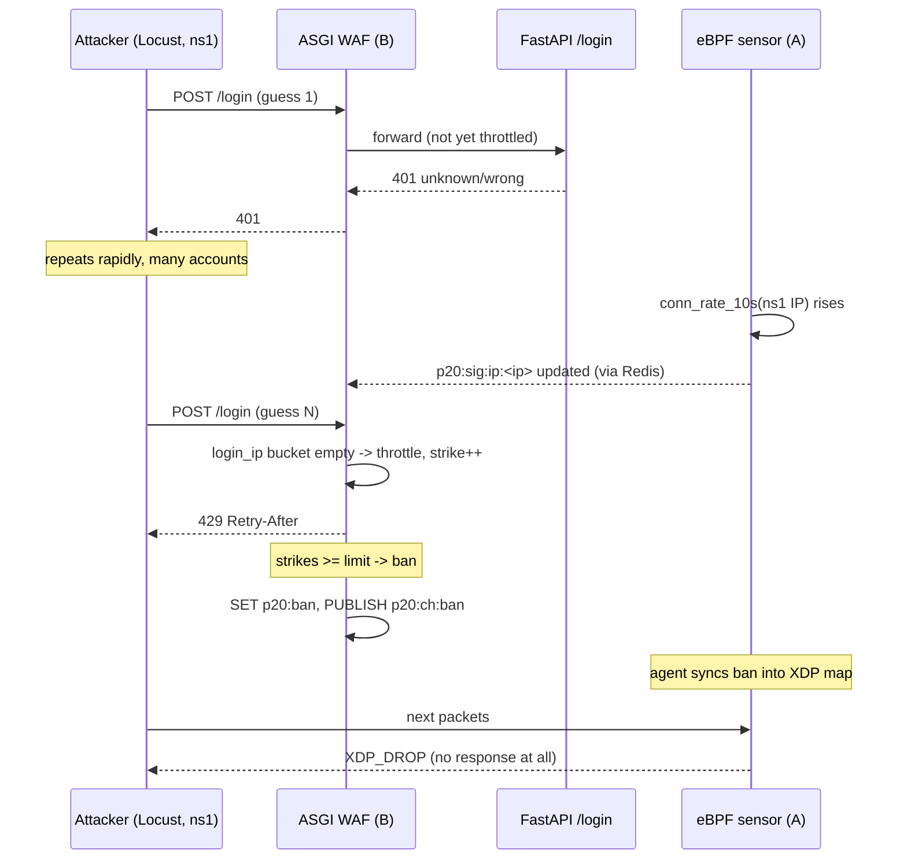

# Project 20: Member A Plan ("Attack & Kernel" track)

> Current policy update, 2026-11-19: fresh [follow-up results](FOLLOWUP_RESULTS.md)
> pass93 component and12 combined validation runs after nine benign-only fits.
> The qualified defaults now use a56,000/7,300-token/s wallet split into small
> (9,000/1,800; tasks<=2,048 tokens) and general lanes, IP capacity60/refill2/s,
> and product-item capacity1,000/refill50/s. All3,780 combined candidate benign
> requests succeeded, with no benign bans or unknowns. Hard spending remains
> explicit opt-in. Scraping volume falls, but the public catalogue remains fully
> extractable in slow/distributed cases. Model/account budgets/schema2 stay fixed.

> Earlier pooled-candidate update, 2026-11-19: [fresh component validation](ACCOUNT_WALLET_REMEDY_RESULTS.md)
> qualifies account-aware escalation: account/global quota denials do not create
> IP budget strikes or corroborate anomaly bans. Account429s remain; IP abuse and
> honeypots still ban. Default `WAF_ACCOUNT_PRESSURE_BANS=0`; explicit1 replays legacy.
> The experimental aggregate40,000/5,700-token/s allowance cuts distributed use20%
> but fails the separate mixed benign comfort gate, so wallet defaults stay0/0.
> It remains opt-in, not an absolute spending cap. Model/account budgets/schema2
> remain fixed. Opened cohorts are excluded from future tuning; C4 remains pending.

> Robustness update, 2026-11-18: [45 fresh fixed-policy runs](ROBUSTNESS_RESULTS.md)
> expose residual slow/distributed abuse and collateral blocking/bans for shared
> accounts and above-capacity legitimate bursts. Within-capacity bursts are a
> separate control. Earlier model acceptance applies to its original workloads.
> No model/policy change was made by this study. B's follow-up is reported above while A continues real sensor/enforcement work; C4 is not a demonstrated fix.


> Current model update, 2026-11-18: directional-volume IsolationForest passed
> fresh offline gates (99.01% recall / 99.58% precision; 5.77% benign flags) and
> an independent 18-run live confirmation (966 benign C3 requests, zero
> denials/unknowns/bans). [Results](DETECTOR_VOLUME_RESULTS.md). The first live grid's shutdown
> failure is preserved; confirmation uses an explicitly recorded lifecycle driver.
> Current artifact: `ml/artifacts/model_base_volume_v1.joblib`; original frozen
> model remains available. Validated budgets/batching and Redis schema2 stay fixed.


> Current execution plan, 2026-11-17. Follow [master plan v1.8](MASTER_PLAN.md)
> and the [professor's feedback](masterplan_vs_professor_diff.pdf).
> Original starter snippets below are superseded where they conflict.
> A owns ebpf/, locust/ and eval/. B owns app/, waf/ and ml/.

## Current handoff

- The traffic handoff and 54-run C2/C3 benchmark exist. They describe the previous
  single-call runtime and feature version 2. Preserve them as historical evidence.
- The chat route now runs 1–8 agent steps, default 3, with a deterministic catalogue
  observation between calls. Each step makes a real HTTP call to the local mock
  with connection close, growing context and exact synthetic token accounting.
- API usage headers sum every iteration. X-Agent-Steps and the response
  iterations explain amplification. Check [the API handoff](../contract/api_handoff.md)
  and [OpenAPI](../contract/openapi.json) before traffic changes.
- Current features are version 3. B completed six fresh C1 runs and 81 matched
  C0/C2/C3 runs under the new runtime. Read the [current results](PROFESSOR_BENCHMARK_RESULTS.md)
  and [professor update](PROFESSOR_UPDATE.md); preserve old rows and manifests.
  B's independent budget, scoring and volume-model acceptance now pass; see
  `DETECTOR_VOLUME_RESULTS.md`. These measurements do not complete IT-1–IT-6 or C4.
- The shared harness now enables compatible C3 models, records their hashes,
  propagates client timeouts, rejects failed workers, and saves app timing snapshots.
- B's calibration fits a 40,000-token burst / 2,400 tokens/s policy from fresh
  benign runs. [36 independent runs meet the policy safety targets](BUDGET_VALIDATION_RESULTS.md),
  with two client shutdown interruptions explicitly retained as unknowns.
  Only the private token-bucket allowance/derived idle expiry changes; ban/signal
  TTLs and Redis schema v2 remain. Record effective policy hashes when comparing
  runs and preserve the original 81-run evidence/model.

## A's tasks and acceptance

- [ ] Record Ubuntu 22.04/24.04, kernel >=5.15, BTF and BCC interpreter/tooling.
  Use scripts/check_environment.py. Passing that check does not load an eBPF program.
- [ ] Capture app-scoped connect and execve as the initial syscall set.
  Attribute outbound connections to API-to-mock port 8001, including loopback,
  and unexpected process execution to the target process/cgroup. Measure accepted
  connections, SYNs, failures and bytes independently.
- [ ] Validate agent amplification by varying agent_steps and input length.
  Record the selected steps, per-iteration tokens, total tokens, cost and actual
  backend calls. Use only synthetic local data and fixed run seeds.
- [ ] Supply real schema-v2 signals with TTLs, timestamps and availability flags.
  Test freshness and missing signals jointly with B before C4.
- [x] Attempt native XDP, then generic/skb. If XDP is unusable, document and test
  tc/nftables enforcement using the same Redis bans, or the allowed WAF fallback
  with the sensor. Record backend, interface, attach mode, fallback reason and
  what was actually blocked. Kernel drop claims require measured kernel drops.
  **Done 2026-11-23:** native failed with `Operation not supported` on the
  `p20br0` bridge master; generic/skb enforced and measured 6 drops. See
  `docs/XDP_ENFORCEMENT.md`.
- [x] Preserve remaining Redis TTL, expiry when the agent dies, dynamic allowlist
  handling, missed-pubsub reconciliation and per-IP enforcement telemetry.
  **Done 2026-11-23:** all five were measured in the same smoke, including a
  successful client after SIGKILL plus TTL expiry with the program still
  attached.
- [x] B ran the current matched C0/C2/C3 campaign using A's workloads and updated
  harness on the Linux VM: 81 valid runs at clean source revision aa51185.
- [ ] After B's calibration and the kernel handoff, run the final matched C0–C4
  campaign with three repetitions, fixed seeds,
  identical agent/tokenizer/latency settings and real namespace source addresses.
  Keep setup and measured traffic separate.
- [ ] Report ASR and token/cost outcomes per attack. Join B's benign FPR, p50/p95
  latency and finalized WAF timing. Report p50/p95 differences against matched C0.
- [ ] Complete IT-1–IT-6 with B, plus slides 2, 3, 4, 7, 9, 12, 13 and 15,
  shared slides 8/17, two rehearsals and the backup demo.

## Next integration point

Delivered on `codex/member-a-kernel` (2026-11-23): the tested sensor and XDP
consumer with launch commands, readiness checks, Redis signal samples,
expiry/allowlist evidence and per-IP drop records, summarized in
[`KERNEL_HANDOFF.md`](KERNEL_HANDOFF.md).

B can now consume the real signals, collect augmented C1 data, train the
augmented model and enable C4. The current API rejects unfinished C4 readiness.
Still joint: IT-1–IT-6, matched C0–C4 with three repetitions per
workload/configuration, joined ASR/FPR/p50/p95 reporting, slides, rehearsals
and the backup recording.

## Original plan and starter examples — reference only where not superseded

Project: **eBPF / Behavioral Runtime Intrusion Detection & Automated Token-Bucket ASGI WAF Against LLM "Denial-of-Wallet"** (Pillar IV: API Security, ISG Tunis, Master SSI 2026-2027).

You are **Member A**. This file is your personal plan and starting guide. It mirrors Member B's plan (`member_B_plan.md`) so the two fit together. It uses the same defaults, not yet confirmed by the professor: eBPF included (sensor + XDP), Linux VM, mock LLM, "Agent Harness" = a simple `/chat` API, ASR = successful malicious requests / total malicious requests, "deterministic" = scripted and reproducible.

---

## 0. Your mission in one page

**You own the attacks and the kernel-level defense.** You build:

1. The **Red Team**: Locust scenarios for credential stuffing, layer-7 scraping and LLM token-exhaustion Denial-of-Wallet, plus a **benign-traffic generator** from several distinct client IPs.
2. The **evaluation harness**: runs attacks against each configuration and computes ASR, detection rate, time-to-ban.
3. The **eBPF layer**: a kernel sensor (connection rates, egress traffic to the LLM, unexpected processes) publishing signals to Redis, plus an **XDP program** that drops packets from banned IPs.
4. The **user-space agent** that bridges Redis and the kernel (reads bans, writes to the BPF map; reads kernel events, writes signals).

**You give Member B:** attack scripts, the benign-traffic generator (several IPs), labeled benign/attacker IP lists for training, eBPF signals in Redis, and the XDP drop acting on B's bans.

**You need from Member B:** the API contract (OpenAPI), demo accounts, honeypot paths, the running baseline + hardened app, and the decision log.

**Your measured metrics:** Attack Success Rate (ASR) per attack type, detection rate, time-to-ban, tokens/cost burned, XDP drop counts, eBPF agent overhead.

**Your owned folders:** `ebpf/`, `locust/`, `eval/`. Shared: `contract/`, `docs/`.

---

## 1. Your work packages

| ID | Work package | Days | Done when |
|---|---|---|---|
| A0 | Linux VM, kernel check, install BCC/bpftrace, hello-world eBPF program, network namespaces + veth for multiple attacker IPs | 1 | A kprobe prints events; two namespaces can both reach the app with different source IPs |
| A1 | Red Team: Locust scenarios (stuffing, scraping, DoW) + datasets + benign-traffic generator (multi-IP) + fixed seeds | 3.5 | All 4 scenarios run against B's baseline and produce logs |
| A2 | Baseline measurement run + evaluation harness (ASR, detection rate, time-to-ban, results CSV) | 1.5 | `eval/results.csv` has one row per (config, attack) with ASR |
| A3 | eBPF **sensor**: connection/accept rates per source IP, outbound bytes to the LLM port, unexpected `execve`; user-space agent publishing to Redis | 3 | `p20:sig:ip:*` and `p20:sig:host` update live while traffic runs |
| A4 | eBPF **XDP enforcement**: banned-IP BPF map, `XDP_DROP`, agent syncing Redis bans into the map, drop counters | 3 | A banned IP's packets are dropped at the interface within 1 second of the ban |
| A5 | Your slides + attack side of the demo | 2 | Slides 2, 3, 4, 7, 9, 12, 13, 15 done; demo script ready |
| J | Joint with B: contract workshop (0.5), integration tests (1.5), final run + rehearsal (1) | 3 | IT-1 to IT-6 pass |

**Total: about 17 days.**

---

## 2. Start here: your first 90 minutes

### 2.1 Environment (Linux VM — same VM family as Member B, or a separate one you can both reach over the network)

```bash
# Check kernel version: 5.x or newer is comfortable for BCC/XDP
uname -r

sudo apt update
sudo apt install -y git curl build-essential python3 python3-venv python3-pip \
  docker.io redis-tools bpfcc-tools linux-headers-$(uname -r) \
  iproute2 bridge-utils clang llvm libbpf-dev

sudo usermod -aG docker $USER      # log out and back in after this

python3 -m venv .venv && source .venv/bin/activate
pip install locust redis httpx numpy pandas bcc 2>/dev/null || true
# If `pip install bcc` fails (common — BCC is usually a system package),
# just use the system python3-bpfcc tools instead and skip the pip package.

mkdir -p ebpf locust eval contract docs
```

### 2.2 Hello-world eBPF check (do this before anything else — confirms your VM can actually run eBPF)

```bash
sudo python3 - << 'PYEOF'
from bcc import BPF
prog = """
int hello(void *ctx) {
    bpf_trace_printk("hello from eBPF\\n");
    return 0;
}
"""
b = BPF(text=prog)
b.attach_kprobe(event=b.get_syscall_fnname("execve"), fn_name="hello")
print("Attached. Run another command in a second terminal, then Ctrl+C here.")
b.trace_print()
PYEOF
```

If this fails (`Failed to compile BPF module`, permission errors), fix it now — everything else depends on it. Common causes: missing kernel headers for your exact kernel, or running without `sudo`, or a WSL2 kernel too old/custom (switch to a real VM).

### 2.3 Multi-IP setup for realistic attacker and benign traffic (network namespaces)

A single Locust process normally sends everything from one source IP, which breaks per-IP rate limiting tests on both sides. Use network namespaces + veth pairs to get several real, distinct source IPs talking to B's app.

```bash
# scripts/make_netns.sh — creates N namespaces (ns1..nsN) bridged to the host
#!/usr/bin/env bash
set -e
N=${1:-5}
BR=p20br0
sudo ip link add $BR type bridge 2>/dev/null || true
sudo ip link set $BR up
for i in $(seq 1 "$N"); do
  NS="ns$i"; VETH_H="veth-h$i"; VETH_N="veth-n$i"
  sudo ip netns add "$NS" 2>/dev/null || true
  sudo ip link add "$VETH_H" type veth peer name "$VETH_N" 2>/dev/null || true
  sudo ip link set "$VETH_N" netns "$NS"
  sudo ip link set "$VETH_H" master "$BR"
  sudo ip link set "$VETH_H" up
  sudo ip netns exec "$NS" ip link set lo up
  sudo ip netns exec "$NS" ip link set "$VETH_N" up
  sudo ip netns exec "$NS" ip addr add "10.20.0.$((10+i))/24" dev "$VETH_N"
done
sudo ip addr add 10.20.0.1/24 dev $BR 2>/dev/null || true
echo "namespaces ns1..ns$N ready, app reachable from host at 10.20.0.1"
```

```bash
chmod +x scripts/make_netns.sh
sudo scripts/make_netns.sh 5
# run B's app bound to 0.0.0.0 on the host, then from inside a namespace:
sudo ip netns exec ns1 curl -s http://10.20.0.1:8000/products?page=1 | head -c 200
```

Each namespace (`ns1`..`ns5`) now has its own IP on the `10.20.0.0/24` subnet and can reach B's app at `10.20.0.1:8000`. Point your Locust workers at the app through the right namespace (see 3.4) so each attacker/benign client gets a distinct, real source IP that the WAF and your eBPF sensor both see correctly.

---

## 3. A1: Red Team — Locust scenarios (starter code)

### 3.1 `locust/common.py`

```python
import json
import random
import string

HOST = "http://10.20.0.1:8000"          # B's app, reached through the bridge (section 2.3)

DEMO_USERS = [f"user{i}" for i in range(1, 51)]        # from B's hand-off (H1)


def random_password(n=10):
    return "".join(random.choices(string.ascii_letters + string.digits, k=n))


def load_leaked_creds(path="locust/data/leaked_creds.txt"):
    """username:password per line — a FEW real demo accounts + many wrong guesses."""
    with open(path) as f:
        for line in f:
            u, _, p = line.strip().partition(":")
            if u:
                yield u, p
```

### 3.2 Build a synthetic "leaked credentials" dataset (do not use real leaked lists — synthetic data only)

```python
# locust/data/make_creds.py
import random
from locust.common import DEMO_USERS, random_password

with open("locust/data/leaked_creds.txt", "w") as f:
    # 5% of attempts use a real demo password (simulates reused/leaked passwords)
    for _ in range(2000):
        u = random.choice(DEMO_USERS)
        if random.random() < 0.05:
            n = int(u.replace("user", ""))
            pwd = f"Passw0rd!{n}"          # matches B's app.main USERS dict
        else:
            pwd = random_password()
        f.write(f"{u}:{pwd}\n")
print("wrote locust/data/leaked_creds.txt")
```

### 3.3 `locust/attack_credential_stuffing.py`

```python
from itertools import cycle

from locust import HttpUser, task, between

from locust.common import HOST, load_leaked_creds

CREDS = cycle(list(load_leaked_creds()))


class CredentialStuffer(HttpUser):
    host = HOST
    wait_time = between(0.05, 0.2)          # fast, bot-like

    @task
    def try_login(self):
        u, p = next(CREDS)
        with self.client.post("/login", json={"username": u, "password": p},
                              catch_response=True) as r:
            if r.status_code == 200:
                r.success()                 # a hit — record it for ASR
            elif r.status_code in (401, 429, 403):
                r.success()                 # expected outcomes, not a Locust "failure"
            else:
                r.failure(f"unexpected {r.status_code}")
```

Run: `locust -f locust/attack_credential_stuffing.py --headless -u 20 -r 5 -t 2m --csv eval/cs`

### 3.4 `locust/attack_scraping.py` (uses the namespaces for several source IPs)

```python
import itertools

from locust import HttpUser, task, constant_pacing

TOTAL_PAGES = 250          # 5,000 products / 20 per page


class Scraper(HttpUser):
    wait_time = constant_pacing(0.3)        # steady, bot-like cadence

    def on_start(self):
        self._pages = itertools.cycle(range(1, TOTAL_PAGES + 1))

    @task
    def crawl(self):
        page = next(self._pages)
        self.client.get(f"/products?page={page}&per_page=20", name="/products")
```

Run one Locust process **per namespace** so each gets a distinct source IP:

```bash
for i in 1 2 3; do
  sudo ip netns exec "ns$i" env PATH="$PATH" \
    locust -f locust/attack_scraping.py --headless -u 5 -r 5 -t 2m \
    --csv "eval/scrape_ns$i" &
done
wait
```

### 3.5 `locust/attack_dow.py` (LLM token-exhaustion Denial-of-Wallet)

```python
import json
import random

from locust import HttpUser, task, between

from locust.common import HOST


class TokenBurner(HttpUser):
    host = HOST
    wait_time = between(0.1, 0.3)
    token = None

    def on_start(self):
        r = self.client.post("/login", json={"username": "user1", "password": "Passw0rd!1"})
        self.token = r.json().get("token")

    @task(3)
    def max_output(self):
        # ask for the largest output the (vulnerable) baseline allows
        self._chat("Write an extremely long, detailed essay about distributed systems.", 32000)

    @task(1)
    def long_prompt(self):
        self._chat("Repeat this context. " * 500 + "Now summarize everything above.", 2000)

    def _chat(self, prompt, max_out):
        headers = {"authorization": f"Bearer {self.token}"} if self.token else {}
        with self.client.post("/chat", json={"prompt": prompt, "max_output_tokens": max_out},
                              headers=headers, catch_response=True) as r:
            if r.status_code == 200:
                out = int(r.headers.get("X-Tokens-Out", 0))
                r.success() if out > 0 else r.failure("no tokens charged")
            elif r.status_code in (429, 400, 403):
                r.success()                 # throttled/blocked — expected under defense
            else:
                r.failure(f"unexpected {r.status_code}")
```

### 3.6 `locust/benign.py` (realistic users — critical for B's training data and your false-positive tests)

```python
import random

from locust import HttpUser, task, between

from locust.common import HOST


class BenignUser(HttpUser):
    host = HOST
    wait_time = between(1, 6)              # human-like pauses
    token = None

    def on_start(self):
        u = random.choice([f"user{i}" for i in range(1, 51)])
        n = int(u.replace("user", ""))
        r = self.client.post("/login", json={"username": u, "password": f"Passw0rd!{n}"})
        self.token = r.json().get("token")

    @task(3)
    def browse(self):
        self.client.get(f"/products?page={random.randint(1, 30)}&per_page=20", name="/products")

    @task(1)
    def chat(self):
        headers = {"authorization": f"Bearer {self.token}"} if self.token else {}
        self.client.post("/chat", json={"prompt": "What's a good birthday gift idea?",
                                        "max_output_tokens": random.randint(50, 300)},
                         headers=headers)
```

Run benign traffic from several namespaces at once (so it looks like several real users, not one IP hammering the app):

```bash
for i in 1 2 3 4 5; do
  sudo ip netns exec "ns$i" env PATH="$PATH" \
    locust -f locust/benign.py --headless -u 3 -r 1 -t 5m --csv "eval/benign_ns$i" &
done
wait
```

**Hand-off H2 to Member B:** once this is running cleanly, tell B which namespace IPs (`10.20.0.11`..`10.20.0.15`) were benign and which were attackers for each run, so B can label training data and compute false positives correctly.

---

## 4. A2: evaluation harness (starter code)

### 4.1 `eval/harness.py`

```python
"""Runs one attack scenario against one configuration and computes ASR."""
import csv
import subprocess
import sys
import time

import redis

CONFIGS = ["C0", "C1", "C2", "C3", "C4"]        # must match waf/config.py on B's side
ATTACKS = {
    "credential_stuffing": "locust/attack_credential_stuffing.py",
    "scraping": "locust/attack_scraping.py",
    "dow": "locust/attack_dow.py",
}

r = redis.Redis(decode_responses=True)


def reset():
    subprocess.run(["bash", "scripts/reset_state.sh"], check=True)   # from member_B_plan.md section 6


def run_attack(name, script, duration_s=60):
    out_prefix = f"eval/{name}"
    subprocess.run(["locust", "-f", script, "--headless", "-u", "10", "-r", "5",
                    "-t", f"{duration_s}s", "--csv", out_prefix], check=True)
    return parse_locust_stats(f"{out_prefix}_stats.csv")


def parse_locust_stats(path):
    total = succeeded_as_attack = 0
    with open(path) as f:
        for row in csv.DictReader(f):
            if row["Name"] == "Aggregated":
                total = int(row["Request Count"])
                succeeded_as_attack = total - int(row["Failure Count"])
    return total, succeeded_as_attack


def time_to_ban(ip, started_ms, timeout_s=10):
    deadline = time.time() + timeout_s
    while time.time() < deadline:
        if r.exists(f"p20:ban:{ip}"):
            return (time.time() * 1000 - started_ms) / 1000.0
        time.sleep(0.1)
    return None


def main():
    reset()
    with open("eval/results.csv", "w", newline="") as f:
        w = csv.writer(f)
        w.writerow(["config", "attack", "total_requests", "attack_success", "asr", "time_to_ban_s"])
        for config in CONFIGS:
            for name, script in ATTACKS.items():
                reset()
                t0 = time.time() * 1000
                total, succeeded = run_attack(name, script)
                asr = succeeded / total if total else 0.0
                ttb = time_to_ban("10.20.0.99", t0)       # adjust to your attacker IP(s)
                w.writerow([config, name, total, succeeded, round(asr, 4), ttb])
                print(config, name, "ASR=", round(asr, 4))


if __name__ == "__main__":
    main()
```

**Note on ASR with Locust:** Locust's own "failure" count is not quite the same as "attack blocked". In each attack script above, a `429/401/403` response is marked `r.success()` in Locust (it is an *expected* outcome for that request) — ASR itself is computed from your own, attack-specific definition of success (a working login found, a page scraped, tokens actually charged), tracked with counters in Redis or a log file in each attack script rather than from the generic Locust pass/fail. Extend each attack script to increment a counter such as `p20:eval:hits:<attack>` only on a genuine objective met, and have `harness.py` read that counter instead of (or in addition to) the Locust stats.

### 4.2 `eval/schema.md` (agree this with Member B before Day 2)

```
eval/results.csv columns:
config, attack, total_requests, attack_success, asr, time_to_ban_s,
latency_p50_ms, latency_p95_ms, latency_p99_ms, false_positive_rate, waf_overhead_ms_mean
```
(This is the original minimal schema, superseded by master-plan section 7. Merge
on run ID, config, workload and repetition; A owns the matching `eval/schema.md` update.)

---

## 5. A3: eBPF sensor (starter code)

### 5.1 `ebpf/sensor.py`

```python
"""User-space agent: attaches BPF probes, aggregates events, publishes to Redis."""
import ctypes as ct
import time
from collections import defaultdict

import redis
from bcc import BPF

r = redis.Redis(decode_responses=True)

BPF_SRC = r"""
#include <uapi/linux/ptrace.h>
#include <net/sock.h>
#include <bcc/proto.h>

struct conn_evt_t { u32 saddr; u64 ts; };
BPF_PERF_OUTPUT(conn_events);

struct exec_evt_t { u32 pid; char comm[16]; u64 ts; };
BPF_PERF_OUTPUT(exec_events);

int trace_accept(struct pt_regs *ctx, struct sock *sk) {
    struct conn_evt_t evt = {};
    evt.saddr = sk->__sk_common.skc_daddr;   // peer address as seen by the server
    evt.ts = bpf_ktime_get_ns();
    conn_events.perf_submit(ctx, &evt, sizeof(evt));
    return 0;
}

int trace_exec(struct pt_regs *ctx) {
    struct exec_evt_t evt = {};
    evt.pid = bpf_get_current_pid_tgid() >> 32;
    bpf_get_current_comm(&evt.comm, sizeof(evt.comm));
    evt.ts = bpf_ktime_get_ns();
    exec_events.perf_submit(ctx, &evt, sizeof(evt));
    return 0;
}
"""

APP_PROCESS_NAME = "python3"          # uvicorn runs as python3/uvicorn — set to your real process name
EXPECTED_CHILD_PROCS = {"python3", "uvicorn"}   # anything else exec'd BY the app is "unexpected"

b = BPF(text=BPF_SRC)
b.attach_kprobe(event="inet_csk_accept", fn_name="trace_accept")
b.attach_kprobe(event=b.get_syscall_fnname("execve"), fn_name="trace_exec")

conn_hits = defaultdict(list)     # ip -> [timestamps]
unexpected_exec_count = 0


def ip_from_int(n: int) -> str:
    import socket, struct
    return socket.inet_ntoa(struct.pack("<I", n))


def handle_conn(cpu, data, size):
    evt = b["conn_events"].event(data)
    ip = ip_from_int(evt.saddr)
    conn_hits[ip].append(time.time())


def handle_exec(cpu, data, size):
    global unexpected_exec_count
    evt = b["exec_events"].event(data)
    comm = evt.comm.decode(errors="replace")
    if comm not in EXPECTED_CHILD_PROCS:
        unexpected_exec_count += 1


b["conn_events"].open_perf_buffer(handle_conn)
b["exec_events"].open_perf_buffer(handle_exec)

print("eBPF sensor running — Ctrl+C to stop")
last_publish = time.time()
while True:
    b.perf_buffer_poll(timeout=200)
    now = time.time()
    if now - last_publish >= 1.0:            # publish aggregates once per second
        for ip, stamps in list(conn_hits.items()):
            stamps[:] = [t for t in stamps if now - t <= 10]     # keep last 10s
            if not stamps:
                del conn_hits[ip]
                continue
            rate_1s = sum(1 for t in stamps if now - t <= 1)
            rate_10s = len(stamps)
            key = f"p20:sig:ip:{ip}"
            r.hset(key, mapping={"conn_rate_1s": rate_1s, "conn_rate_10s": rate_10s,
                                 "syn_rate_10s": rate_10s, "failed_conn_10s": 0,
                                 "bytes_in_10s": 0, "updated_ms": int(now * 1000)})
            r.expire(key, 60)
        r.hset("p20:sig:host", mapping={"egress_bytes_llm_60s": 0, "egress_conns_llm_60s": 0,
                                        "unexpected_exec_count": unexpected_exec_count,
                                        "updated_ms": int(now * 1000)})
        r.expire("p20:sig:host", 120)
        last_publish = now
```

Run: `sudo python3 ebpf/sensor.py` (needs root to load BPF programs). **This is a starting point, not production eBPF.** The connection tracking (`inet_csk_accept`) and egress byte counting (currently a placeholder at 0) need real work — see Section 5.2.

### 5.2 Egress-to-LLM tracking (fill this in — it is the Denial-of-Wallet signal)

Attach a kprobe or tracepoint on `tcp_sendmsg`/`tcp_cleanup_rbuf` filtered by the destination port your mock LLM uses (or, more realistically, by the real LLM provider's port/IP if you use a real API in Phase 2). Aggregate bytes sent in the last 60 seconds into `egress_bytes_llm_60s`. This is the field Member B's IT-3 cost cross-check compares against the app's own token accounting (`/_metrics/usage`).

### 5.3 Test the sensor is alive

```bash
redis-cli HGETALL p20:sig:host
redis-cli --scan --pattern 'p20:sig:ip:*' | xargs -n1 redis-cli HGETALL
```
Run `locust/attack_scraping.py` from a namespace and confirm `conn_rate_10s` for that IP rises.

---

## 6. A4: XDP enforcement (starter code)

### 6.1 `ebpf/xdp_ban.py`

```python
"""Loads an XDP program with a banned-IP map; a sidecar thread syncs Redis bans into it."""
import socket
import struct
import threading
import time

import redis
from bcc import BPF

r = redis.Redis(decode_responses=True)

XDP_SRC = r"""
#include <uapi/linux/bpf.h>
#include <uapi/linux/if_ether.h>
#include <uapi/linux/ip.h>

BPF_HASH(banned_ips, u32, u8, 10240);
BPF_ARRAY(drop_count, u64, 1);

int xdp_drop_banned(struct xdp_md *ctx) {
    void *data = (void *)(long)ctx->data;
    void *data_end = (void *)(long)ctx->data_end;
    struct ethhdr *eth = data;
    if ((void *)(eth + 1) > data_end) return XDP_PASS;
    if (eth->h_proto != __constant_htons(ETH_P_IP)) return XDP_PASS;
    struct iphdr *ip = (void *)(eth + 1);
    if ((void *)(ip + 1) > data_end) return XDP_PASS;

    u32 src = ip->saddr;
    u8 *hit = banned_ips.lookup(&src);
    if (hit) {
        u32 idx = 0;
        u64 *c = drop_count.lookup(&idx);
        if (c) (*c)++;
        return XDP_DROP;
    }
    return XDP_PASS;
}
"""


def ip_to_u32(ip: str) -> int:
    return struct.unpack("<I", socket.inet_aton(ip))[0]   # little-endian to match saddr byte order


def load_xdp(iface: str):
    b = BPF(text=XDP_SRC)
    fn = b.load_func("xdp_drop_banned", BPF.XDP)
    b.attach_xdp(iface, fn, 0)
    print(f"XDP program attached to {iface}")
    return b


def sync_loop(b):
    banned_map = b["banned_ips"]
    pubsub = r.pubsub()
    pubsub.subscribe("p20:ch:ban")

    def reconcile():
        """Full resync every 2s — covers missed pub/sub messages (contract rule)."""
        wanted = set()
        for key in r.scan_iter("p20:ban:*"):
            wanted.add(key.split(":")[-1])
        current = {socket.inet_ntoa(struct.pack("<I", k.value)) for k, _ in banned_map.items()}
        for ip in wanted - current:
            if r.sismember("p20:allowlist", ip):          # never ban the allowlist
                continue
            banned_map[ct_u32(ip)] = ct_u8(1)
        for ip in current - wanted:
            del banned_map[ct_u32(ip)]

    def ct_u32(ip):
        import ctypes
        return ctypes.c_uint32(ip_to_u32(ip))

    def ct_u8(v):
        import ctypes
        return ctypes.c_uint8(v)

    last_reconcile = 0
    while True:
        msg = pubsub.get_message(timeout=1.0)
        if msg and msg["type"] == "message":
            reconcile()                                    # a ban or unban arrived — resync now
        if time.time() - last_reconcile > 2:
            reconcile()
            last_reconcile = time.time()


if __name__ == "__main__":
    import sys
    iface = sys.argv[1] if len(sys.argv) > 1 else "eth0"   # use your bridge/veth interface, e.g. p20br0
    bpf = load_xdp(iface)
    try:
        sync_loop(bpf)
    except KeyboardInterrupt:
        pass
```

Run: `sudo python3 ebpf/xdp_ban.py p20br0` (or the real interface facing your attacker namespaces — check with `ip link`).

**Test it manually before relying on it:**
```bash
redis-cli SET p20:ban:10.20.0.12 '{"ip":"10.20.0.12","reason":"test","source":"waf","ts_ms":0,"ttl_s":60}' EX 60
redis-cli PUBLISH p20:ch:ban '{"op":"add","ip":"10.20.0.12","ttl_s":60,"reason":"test"}'
# from ns2 (whichever namespace has 10.20.0.12):
sudo ip netns exec ns2 curl -m 3 http://10.20.0.1:8000/products      # should now time out / fail
```

**Mode verification required:** explicitly select/check the supported XDP mode on
the target interface and record the observed result. Do not infer the mode from
this snippet or claim native performance/universal support without verification.

---

## 7. Your side of the Redis Bridge (integration with Member B — this is where you stop and hand off)

This is the exact point where your track and B's track meet. Everything above this line is yours alone; everything in this section is shared contract — do not change these key names or shapes without updating B.

| Key / channel | You | Notes |
|---|---|---|
| `p20:sig:ip:<ip>` | **write** | `conn_rate_1s, conn_rate_10s, syn_rate_10s, failed_conn_10s, bytes_in_10s, updated_ms`, TTL 60s |
| `p20:sig:host` | **write** | `egress_bytes_llm_60s, egress_conns_llm_60s, unexpected_exec_count, updated_ms`, TTL 120s |
| `p20:stream:ebpf_events` | **write** (optional, for richer detection) | `type` (`conn_burst`, `egress_spike`, `unexpected_exec`), `ip`, `pid`, `comm`, `detail`, `ts_ms` |
| `p20:ban:<ip>` | **read** (sync into XDP map); **write** only for your own hard-threshold bans (`ebpf_conn_flood`) | same JSON shape B uses |
| `p20:ch:ban` | **subscribe** | `{"op":"add"|"del","ip","ttl_s","reason"}` |
| `p20:xdp:drops` | **write** | `total_dropped_pkts, dropped_pkts:<ip>, map_size, updated_ms` |
| `p20:allowlist` | **read** | never ban/drop these IPs (your VM host, Redis host, test runner) |
| `p20:stream:waf_decisions` | **read** (your eval harness) | `ts_ms, ip, client_id, route, decision, reason, anomaly_score, llm_tokens_charged, latency_ms` |

**You stop here and B's layer takes over:** once your sensor writes `p20:sig:*` and your XDP program enforces `p20:ban:*`, your job for a given request is done — B's middleware reads your signals as ML features and decides allow/throttle/block/ban; your agent then only has to notice B's ban and sync the map. You never read request bodies, headers or application logic — that is entirely B's side.

### 7.1 Develop without waiting for B: `contract/fake_waf.py`

```python
# Usage: python contract/fake_waf.py 10.20.0.12   (pretend the WAF just banned this IP)
import json
import sys
import time

import redis

r = redis.Redis(decode_responses=True)
ip = sys.argv[1]
payload = {"ip": ip, "reason": "honeypot", "source": "waf", "ts_ms": int(time.time() * 1000), "ttl_s": 60}
r.set(f"p20:ban:{ip}", json.dumps(payload), ex=60)
r.publish("p20:ch:ban", json.dumps({"op": "add", "ip": ip, "ttl_s": 60, "reason": "honeypot"}))
print("fake ban written for", ip)
```

Use this to test `ebpf/xdp_ban.py` end-to-end before B's middleware exists.

### 7.2 Integration tests you take part in

| ID | Test | Your part |
|---|---|---|
| IT-1 | Honeypot hit leads to a kernel drop in 1 second or less | Your sync loop must pick up the ban fast (pub/sub + 2s reconcile) |
| IT-2 | eBPF connection burst raises the WAF's anomaly score / strikes | Your sensor must publish `conn_rate_10s` correctly and promptly |
| IT-3 | Cost cross-check: your egress bytes vs B's token accounting agree within a tolerance | Finish the egress tracking in Section 5.2 |
| IT-4 | Closed loop: time-to-ban from first malicious request to first XDP drop | Your `p20:xdp:drops` counters + B's decision timestamps |
| IT-5 | Failure modes: your agent stopped, Redis stopped | Make sure the app keeps working without you (test by killing your agent mid-attack) |
| IT-6 | No false bans on benign traffic | Tune your hard-threshold ban (if any) conservatively; most banning should come from B |

---

## 8. Configurations you run against (same as B's — keep in sync)

| Config | Meaning | What you run |
|---|---|---|
| **C0** | Vulnerable baseline | All 3 attacks + benign, B's app with `WAF_MODE=off` |
| **C1** | Observe only | Benign + attacks, collects B's training data |
| **C2** | Buckets + honeypot | Attacks should now be throttled/blocked |
| **C3** | C2 + IsolationForest | Attacks should be detected even when budgets alone miss them |
| **C4** | C3 + your eBPF signals and XDP drops | Full stack — run your sensor and `xdp_ban.py` alongside |

For C4, start in this order: Redis → B's app (`WAF_MODE=enforce ... WAF_EBPF_SIGNALS=1`) → your sensor (`sudo python3 ebpf/sensor.py`) → your XDP loader (`sudo python3 ebpf/xdp_ban.py <iface>`) → then run attacks.

---

## 9. A5: the slides you own (8 of 18) and what to put in them

| # | Slide | Content to prepare |
|---|---|---|
| 2 | Formal threat model | Assets (accounts, data, LLM budget, host), actors, entry points, impact/likelihood per attack |
| 3 | Attack catalogue | One slide per attack with the mechanics: credential stuffing, layer-7 scraping, LLM token-exhaustion DoW |
| 4 | CWE + OWASP API Security Top 10 mapping | CWE-307 (auth attempt restriction), CWE-770 (resource allocation without limits), CWE-799 (interaction frequency); OWASP API Security Top 10 (2023): API2, API4, API6. **Verify exact names/IDs on the official OWASP page before citing** |
| 7 | eBPF layer architecture | Sensor → Redis → agent → XDP map, drawn by you |
| 9 | Attack sequence diagrams (drawn by your team) | Starter below |
| 12 | Install/config: Linux/VM, BCC, XDP, Locust, namespaces | Your Section 2 and 3 commands, kernel version requirement |
| 13 | Cited comparison matrix 1: where to enforce | Table below |
| 15 | Results: ASR, detection rate, time-to-ban, tokens/cost burned | Charts from `eval/results.csv` |

Joint slides with B: 8 (Redis Bridge) and 17 (live demo).

### Mermaid starter for the credential-stuffing attack sequence diagram



### Comparison matrix starter (slide 13): where to enforce — you must add citations

| Enforcement point | Can see | Overhead | Can weight by cost (LLM tokens) | Notes |
|---|---|---|---|---|
| **eBPF/XDP (chosen, kernel)** | Packet/connection level | Very low | No (no app semantics) | Fast drop, blind to payload |
| iptables/nftables | Packet/connection level | Low | No | Simpler, less flexible than eBPF |
| Reverse-proxy WAF (e.g. Nginx + ModSecurity) | Full HTTP request | Medium | Partial | Extra network hop |
| **In-app ASGI middleware (chosen, B's layer)** | Full HTTP request + app state | Low–medium (in-process) | **Yes** | Needed for LLM token budgets |

**Sources to find and cite:** the eBPF and XDP documentation (kernel.org, Cilium's eBPF documentation), the BCC project documentation, OWASP API Security Top 10 (2023), a comparative paper or blog on kernel-level vs application-level rate limiting (for example Cloudflare's or Cilium's engineering blog on XDP-based mitigation). Verify titles/URLs yourself before citing.

---

## 10. Timeline for Member A

| Week | Your work | Checkpoint |
|---|---|---|
| **1** | Day 1: A0 (VM, BCC hello-world, namespaces) + contract workshop with B (0.5 day). Days 2-5: A1 (all Locust scenarios + benign generator), send H2 (benign IPs/dataset) toward end of week | **IC0:** contract frozen, `fake_waf.py` exists, your attacks run against B's baseline |
| **2** | A2 (evaluation harness, baseline ASR results on C0), start A3 (sensor) | **IC1:** baseline attacks succeed on C0 (high ASR) and are reduced on C2 |
| **3** | Finish A3, A4 (XDP map + enforcement), IT-1 and IT-2 with B's real middleware | **IC2:** IT-1 and IT-2 pass |
| **4** | A5 slides, IT-3 to IT-6, full C0–C4 run with B, demo rehearsal x2 | **IC3:** demo ready |

---

## 11. Messages to send Member B today

1. "Day 1 workshop: let's freeze the Redis contract and the `results.csv` columns (see `eval/schema.md`)."
2. "I'm building the benign generator with 5 distinct source IPs via network namespaces (`10.20.0.11`-`15`) — tell me if your per-IP bucket limits need adjusting for that."
3. "I'll have `fake_waf.py` ready so you don't need my real eBPF/XDP code running to test your middleware early."
4. "Please keep my VM host IP and the Redis host IP on `p20:allowlist` only — I will never add attacker IPs there."
5. "My `latency_ms` interest is end-to-end per request from Locust stats — confirm your `latency_ms` in the decision stream is WAF overhead only, not end-to-end, so we don't double-count."

---

## 12. Pitfalls to avoid

- **Single-IP attacks look unrealistic and also break per-IP rate-limit testing.** Always use the namespace setup for both attacks and benign traffic.
- **XDP needs the right interface.** Attaching to `lo` (loopback) behaves differently from a real interface — use the bridge/veth interface facing your namespaces.
- **BCC compiles C code against your exact running kernel headers.** If you change VM/kernel, reinstall matching `linux-headers-$(uname -r)`.
- **Root required.** Both `sensor.py` and `xdp_ban.py` need `sudo`. Plan your demo script around that (don't forget passwords mid-demo).
- **Locust's pass/fail is not your ASR.** Define and log attack-specific "success" (Section 4.1) rather than relying on HTTP status codes alone.
- **Reconcile, don't trust pub/sub alone.** A missed Redis pub/sub message must not leave a stale XDP map — always keep the periodic full resync.
- **Never put attacker IPs on the allowlist**, even by accident during testing — check this before every run.
- **Reproducibility:** fixed seeds in your credential dataset generation, same namespace IPs every run, run `scripts/reset_state.sh` (B's script) before every measured run.
- **Egress tracking is the hardest part of A3 — start it early**, it directly feeds IT-3 and your DoW story.

---

## 13. Definition of done (your checklist)

- [ ] A0: VM ready, BCC hello-world works, namespaces/veth bridge working with multiple IPs
- [ ] A1: all 3 attacks + benign generator run against B's baseline, synthetic creds dataset only
- [ ] H2 sent: benign/attacker IP lists and dataset for B's IsolationForest training
- [ ] A2: evaluation harness produces `eval/results.csv` with ASR per config/attack
- [ ] A3: sensor publishes `p20:sig:ip:*` and `p20:sig:host` live, including egress bytes (Section 5.2 completed)
- [x] A4: XDP program loaded, banned IPs dropped within 1s, drop counters in `p20:xdp:drops`
  (2026-11-23: generic/skb on `p20br0`; ban in the map 1.0ms after `PUBLISH`;
  `TimeoutError` for the banned client; `total_dropped_pkts` and
  `dropped_pkts:10.20.0.25` measured)
- [ ] `fake_waf.py` committed and used to test A4 independently
- [ ] IT-1 to IT-6 pass with B
- [ ] Slides 2, 3, 4, 7, 9, 12, 13, 15 done (+ joint 8 and 17)
- [ ] One-command reproducible run (`eval/harness.py` + your sensor/XDP scripts); backup demo video recorded
- [ ] You can explain the whole project, including B's WAF/IsolationForest layer, at a high level
