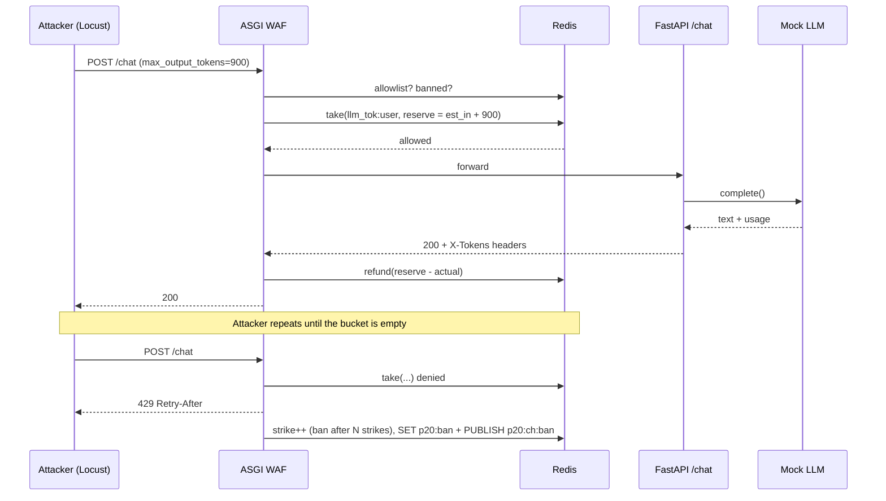

# Project 20: Member B Plan ("Application & Intelligence" track)

> Execution update — 2026-11-16: follow [the coordinated master plan](docs/MASTER_PLAN.md)
> and [Redis Bridge schema v2](contract/redis_schema.md) for current decisions.
> This original plan is retained as background and starter examples. The master
> plan supersedes conflicting snippets, metrics, failure behavior and ML policy.
> Key updates: local HTTP mock in every configuration; calibrated byte/token
> cross-check; complete non-enforcing observation; corroborated ML bans; explicit
> outage/recovery behavior; labeled run-based evaluation. C0–C4 meanings and flag
> names remain unchanged. Track implementation evidence in
> [the project journal](docs/PROJECT_JOURNAL.md).
> Visual scope now includes a demo app and read-only management dashboard; see
> master-plan section 4 for staged delivery and access/testing requirements.
> Independent implementation update: C0/C1/C2 application checks, cached-auth/local
> budget outage handling, and base ML tooling are implemented. Production model
> training, realistic detector metrics, A's attack validation and C4 remain pending.
> See `docs/evidence/independent_status.json` and the latest journal entry.

Project: **eBPF / Behavioral Runtime Intrusion Detection & Automated Token-Bucket ASGI WAF Against LLM "Denial-of-Wallet"** (Pillar IV: API Security, ISG Tunis, Master SSI 2026-2027).

You are **Member B**. This file is your personal plan and starting guide. It uses the defaults below (nothing has been confirmed by the professor yet). The code is a **starter**: it is meant to run and to be extended, not to be submitted as-is.

---

## 0. Assumptions (defaults, to confirm with the professor)

| # | Assumption | If the professor says otherwise |
|---|---|---|
| 1 | eBPF is part of the project: Member A builds a kernel sensor + XDP drop and connects it to your WAF through Redis | If eBPF is sensor-only, you drop the "bans go down" part. If optional, the bridge shrinks |
| 2 | Everything runs on a **Linux VM** | Affects only how you run Redis/app |
| 3 | The LLM is a **mock** with token counting | If a real LLM is required, you replace `mock_llm.py` with a client and keep the same usage headers |
| 4 | "Agent Harness" = a simple API app with a `/chat` endpoint calling the LLM | If it must be a real agent with tools, you add a tool loop to the app and extra budgets (tool calls per task) |
| 5 | ASR = successful malicious requests / total malicious requests, per attack | Changes only A's harness and how you present results |
| 6 | "Deterministic" = scripted, seeded, reproducible runs | Adds a reset script and fixed seeds (already in this plan) |

---

## 1. Your mission in one page

**You own the target and the application-layer defense.** You build:

1. The **vulnerable baseline** (FastAPI app + mock LLM + token accounting) that Member A attacks.
2. The **ASGI behavioral WAF** (middleware) with Redis token buckets (requests and LLM tokens), honeypot, strikes and auto-ban.
3. The **IsolationForest** anomaly scoring (features, training, thresholds, integration).
4. **Latency / false-positive / overhead measurements.**
5. **Your 8 slides** (and 2 joint ones with A), plus half of the demo.

**You give Member A:** the API contract (OpenAPI), ban format, honeypot paths, the decision log, and a running baseline + hardened app.
**You need from Member A:** attack scripts, a benign-traffic generator (with multiple client IPs), eBPF signals in Redis, and the XDP drop on bans.

**Your measured metrics:** latency p50/p95/p99 (baseline vs WAF vs WAF + eBPF), false-positive rate, WAF CPU/memory, model scoring time.

**Your owned folders:** `app/`, `waf/`, `ml/`, `common/`. Shared: `contract/`, `docs/`.

---

## 2. Your work packages

| ID | Work package | Days | Done when |
|---|---|---|---|
| B0 | Repo, venv, Redis, project skeleton, test command | 1 | `pytest` runs, Redis reachable, app starts |
| B1 | Vulnerable baseline: `/login`, `/products`, `/chat`, mock LLM, token accounting, OpenAPI | 2.5 | Attacker can stuff logins, crawl products and burn tokens with no limit; `contract/openapi.json` shared |
| B2 | Token-bucket ASGI middleware (requests, login per IP and per account, LLM tokens with reserve/refund), Lua, 429 + `Retry-After` | 2.5 | Unit tests pass; Locust attack gets throttled; benign traffic passes |
| B3 | Honeypot routes + strikes + ban writer (+ pub/sub) + allowlist | 1.5 | Honeypot hit creates `p20:ban:<ip>` and publishes the event; repeated 429s lead to a ban |
| B4 | IsolationForest: features, data collection (observe mode), training, thresholds, integration, evaluation | 3.5 | Model saved; precision/recall on attack vs benign reported; middleware uses it |
| B5 | Measurements: latency, false positives, overhead, across configs C0 to C4 | 1 | One `results.csv` with all configs |
| B6 | Your slides + defense side of the demo | 2 | Slides 1, 5, 6, 10, 11, 14, 16, 18 done; demo script ready |
| J | Joint with A: contract workshop (0.5), integration tests (1.5), final run + rehearsal (1) | 3 | IT-1 to IT-6 pass |

**Total: about 17 days.**

---

## 3. Start here: your first 90 minutes

### 3.1 Environment (Linux VM)

```bash
# Python 3.11+ and Docker installed
mkdir project20 && cd project20
git init
python3 -m venv .venv && source .venv/bin/activate
pip install fastapi "uvicorn[standard]" redis scikit-learn numpy pandas joblib pytest pytest-asyncio httpx
pip freeze > requirements.txt

mkdir -p app waf ml/data common contract docs scripts tests
touch app/__init__.py waf/__init__.py ml/__init__.py common/__init__.py

# Redis
docker run -d --name p20-redis -p 6379:6379 redis:7
docker exec p20-redis redis-cli ping    # expect PONG
```

`pytest.ini`:

```ini
[pytest]
asyncio_mode = auto
```

### 3.2 Shared helper `common/tokens.py` (used by the app AND the WAF, so both count tokens the same way)

```python
def estimate_tokens(text: str) -> int:
    """About 4 characters per token. Same function in the app and the WAF."""
    return max(1, len(text) // 4)
```

### 3.3 Mock LLM `app/mock_llm.py`

```python
import asyncio
from common.tokens import estimate_tokens

IN_PER_1K = 0.003      # simulated price per 1k input tokens (USD)
OUT_PER_1K = 0.015     # simulated price per 1k output tokens (USD)
OUTPUT_HARD_CAP = 32_000   # deliberately huge in the baseline (vulnerable)


async def complete(prompt: str, max_output_tokens: int):
    n_in = estimate_tokens(prompt)
    n_out = max(1, min(max_output_tokens, OUTPUT_HARD_CAP))
    await asyncio.sleep(min(n_out / 20_000, 2.0))        # simulated generation time
    text = ("lorem " * n_out)[: n_out * 4]               # about n_out tokens
    cost = n_in / 1000 * IN_PER_1K + n_out / 1000 * OUT_PER_1K
    return text, n_in, n_out, cost
```

### 3.4 Vulnerable baseline `app/main.py`

```python
import os
import secrets

import redis.asyncio as aioredis
from fastapi import FastAPI, Header, HTTPException, Response
from pydantic import BaseModel

from app.mock_llm import complete

REDIS_URL = os.getenv("REDIS_URL", "redis://localhost:6379/0")
r = aioredis.from_url(REDIS_URL, decode_responses=True)

# Demo accounts (the target's account store is not the point of the project)
USERS = {f"user{i}": f"Passw0rd!{i}" for i in range(1, 51)}
PRODUCTS = [{"id": i, "name": f"Product {i}", "price": round(5 + (i * 37) % 200, 2)}
            for i in range(1, 5001)]

app = FastAPI(title="P20 target API")


class LoginIn(BaseModel):
    username: str
    password: str


class ChatIn(BaseModel):
    prompt: str
    max_output_tokens: int = 256


@app.post("/login")
async def login(body: LoginIn):
    # VULNERABLE BY DESIGN:
    #  - no rate limit and no lockout (CWE-307)
    #  - different errors for unknown user / wrong password (user enumeration)
    if body.username not in USERS:
        raise HTTPException(401, "unknown user")
    if USERS[body.username] != body.password:
        raise HTTPException(401, "wrong password")
    token = secrets.token_hex(16)
    await r.set(f"p20:app:session:{token}", body.username, ex=3600)
    return {"token": token}


@app.get("/products")
async def products(page: int = 1, per_page: int = 20):
    # VULNERABLE BY DESIGN: no throttling, anyone can crawl everything (CWE-770)
    per_page = max(1, min(per_page, 100))
    start = (max(page, 1) - 1) * per_page
    return {"page": page, "items": PRODUCTS[start:start + per_page], "total": len(PRODUCTS)}


async def current_user(authorization: str | None) -> str:
    if not authorization or not authorization.startswith("Bearer "):
        raise HTTPException(401, "missing token")
    user = await r.get(f"p20:app:session:{authorization[7:]}")
    if not user:
        raise HTTPException(401, "invalid token")
    return user


@app.post("/chat")
async def chat(body: ChatIn, response: Response, authorization: str | None = Header(default=None)):
    # VULNERABLE BY DESIGN: no per-user token budget, max_output_tokens up to 32,000
    user = await current_user(authorization)
    text, n_in, n_out, cost = await complete(body.prompt, body.max_output_tokens)
    response.headers["X-Tokens-In"] = str(n_in)
    response.headers["X-Tokens-Out"] = str(n_out)
    response.headers["X-Cost-USD"] = f"{cost:.6f}"
    pipe = r.pipeline()
    pipe.hincrby("p20:app:usage:total", "requests", 1)
    pipe.hincrby("p20:app:usage:total", "tokens_in", n_in)
    pipe.hincrby("p20:app:usage:total", "tokens_out", n_out)
    pipe.hincrbyfloat("p20:app:usage:total", "cost_usd", cost)
    pipe.hincrbyfloat(f"p20:app:usage:{user}", "cost_usd", cost)
    await pipe.execute()
    return {"text": text, "usage": {"tokens_in": n_in, "tokens_out": n_out, "cost_usd": cost}}


@app.get("/_metrics/usage")
async def usage():
    # Used by Member A's evaluation harness (their IP is on the allowlist)
    return await r.hgetall("p20:app:usage:total")


@app.get("/robots.txt")
async def robots():
    return Response("User-agent: *\nDisallow: /admin-backup/\nDisallow: /internal/export\n",
                    media_type="text/plain")


# The hardened version is the SAME app with the middleware switched on by an env var,
# so baseline vs hardened comparisons are fair.
if os.getenv("WAF_MODE", "off") != "off":
    from waf.middleware import WAFMiddleware
    app.add_middleware(WAFMiddleware)
```

Run and smoke test:

```bash
WAF_MODE=off uvicorn app.main:app --host 0.0.0.0 --port 8000

curl -s "localhost:8000/products?page=1" | head -c 300
TOKEN=$(curl -s -X POST localhost:8000/login -H 'content-type: application/json' \
  -d '{"username":"user1","password":"Passw0rd!1"}' | python -c 'import sys,json;print(json.load(sys.stdin)["token"])')
curl -si -X POST localhost:8000/chat -H "authorization: Bearer $TOKEN" \
  -H 'content-type: application/json' -d '{"prompt":"hello","max_output_tokens":50}' | head -15
curl -s localhost:8000/_metrics/usage
```

### 3.5 Hand-off H1 (do this on Day 2 at the latest)

```bash
curl -s localhost:8000/openapi.json > contract/openapi.json
```

Send Member A: `contract/openapi.json`, the 50 demo accounts (`user1..user50`, password `Passw0rd!<n>`), how token usage is reported (`X-Tokens-In`, `X-Tokens-Out`, `X-Cost-USD` headers and `/_metrics/usage`), and the honeypot paths (`/admin-backup/`, `/internal/export`, `/.env`).

**B1 acceptance test (the baseline must be attackable):**
- 1,000 login attempts in a minute are all processed.
- All 5,000 products can be crawled in 50 requests without any limit.
- Repeated `/chat` with `max_output_tokens=32000` burns tokens and `/_metrics/usage` shows the growing cost.

---

## 4. B2 and B3: the WAF (starter code)

### 4.1 `waf/config.py`

```python
import os
from dataclasses import dataclass, field


def _flag(name: str, default: str = "1") -> bool:
    return os.getenv(name, default) == "1"


@dataclass(frozen=True)
class Config:
    mode: str = os.getenv("WAF_MODE", "off")            # off | observe | enforce
    redis_url: str = os.getenv("REDIS_URL", "redis://localhost:6379/0")
    enable_buckets: bool = _flag("WAF_BUCKETS", "1")
    enable_honeypot: bool = _flag("WAF_HONEYPOT", "1")
    enable_ml: bool = _flag("WAF_ML", "0")
    use_ebpf_signals: bool = _flag("WAF_EBPF_SIGNALS", "0")

    honeypot_paths: tuple = ("/admin-backup", "/internal/export", "/.env")
    ban_ttl_s: int = 600
    strike_limit: int = 5
    strike_window_s: int = 300
    max_output_cap: int = 1024          # policy: reject max_output_tokens above this
    max_body_bytes: int = 1_000_000

    # (capacity, refill_per_second): starting values, tune them with benign traffic
    budgets: dict = field(default_factory=lambda: {
        "ip_req":     (30, 2.0),          # all routes, per source IP
        "login_ip":   (5, 5 / 60),        # 5 burst, then 5 per minute per IP
        "login_acct": (5, 5 / 900),       # 5 burst, then 5 per 15 min per ACCOUNT
        "chat_req":   (10, 0.5),          # per user
        "llm_tok":    (20_000, 100.0),    # LLM tokens per user (about 6,000 per minute)
    })

    allowlist_key: str = "p20:allowlist"
    decisions_stream: str = "p20:stream:waf_decisions"
    features_stream: str = "p20:stream:waf_features"

    @property
    def model_path(self) -> str:
        return "ml/model_ebpf.joblib" if self.use_ebpf_signals else "ml/model_base.joblib"


CFG = Config()
```

### 4.2 `waf/buckets.py` (atomic token bucket in Redis Lua)

```python
TAKE_LUA = """
local capacity = tonumber(ARGV[1])
local rate     = tonumber(ARGV[2])
local cost     = tonumber(ARGV[3])
local t        = redis.call('TIME')
local now      = tonumber(t[1]) * 1000 + math.floor(tonumber(t[2]) / 1000)
local d        = redis.call('HMGET', KEYS[1], 'tokens', 'ts')
local tokens   = tonumber(d[1])
local ts       = tonumber(d[2])
if tokens == nil then tokens = capacity; ts = now end
tokens = math.min(capacity, tokens + (math.max(0, now - ts) / 1000.0) * rate)
local allowed, retry_ms = 0, 0
if tokens >= cost then
  tokens = tokens - cost
  allowed = 1
else
  retry_ms = math.ceil((cost - tokens) / rate * 1000)
end
redis.call('HSET', KEYS[1], 'tokens', tokens, 'ts', now)
redis.call('PEXPIRE', KEYS[1], math.ceil(capacity / rate * 1000) * 2 + 1000)
return {allowed, tostring(tokens), retry_ms}
"""

REFUND_LUA = """
local capacity = tonumber(ARGV[1])
local amount   = tonumber(ARGV[2])
local cur = tonumber(redis.call('HGET', KEYS[1], 'tokens'))
if cur == nil then return 0 end
redis.call('HSET', KEYS[1], 'tokens', math.min(capacity, cur + amount))
return 1
"""


class TokenBucket:
    def __init__(self, r):
        self._take = r.register_script(TAKE_LUA)
        self._refund = r.register_script(REFUND_LUA)

    async def take(self, key: str, capacity: float, refill_per_s: float, cost: float = 1):
        allowed, tokens, retry_ms = await self._take(keys=[key], args=[capacity, refill_per_s, cost])
        return bool(allowed), float(tokens), retry_ms / 1000.0     # retry in seconds

    async def refund(self, key: str, capacity: float, amount: float):
        await self._refund(keys=[key], args=[capacity, amount])
```

Unit test `tests/test_buckets.py`:

```python
import asyncio
import redis.asyncio as aioredis
from waf.buckets import TokenBucket


async def test_burst_reject_refill():
    r = aioredis.from_url("redis://localhost:6379/15", decode_responses=True)
    await r.flushdb()
    tb = TokenBucket(r)
    res = [(await tb.take("t", 5, 1, 1))[0] for _ in range(7)]
    assert res == [True] * 5 + [False] * 2          # burst of 5, then rejected
    await asyncio.sleep(2.1)
    assert (await tb.take("t", 5, 1, 1))[0] is True  # refilled about 2 tokens
    # weighted cost (the LLM token case)
    assert (await tb.take("big", 100, 10, 150))[0] is False
```

### 4.3 `waf/bans.py` (B3: ban writer, strikes, allowlist)

```python
import json
import time

from waf.config import CFG


async def is_banned(r, ip: str) -> bool:
    return await r.exists(f"p20:ban:{ip}") == 1


async def ban(r, ip: str, reason: str, ttl_s: int, source: str = "waf") -> bool:
    if await r.sismember(CFG.allowlist_key, ip):
        return False                                   # never ban the allowlist
    payload = {"ip": ip, "reason": reason, "source": source,
               "ts_ms": int(time.time() * 1000), "ttl_s": ttl_s}
    pipe = r.pipeline()
    pipe.set(f"p20:ban:{ip}", json.dumps(payload), ex=ttl_s)
    pipe.publish("p20:ch:ban", json.dumps({"op": "add", "ip": ip, "ttl_s": ttl_s, "reason": reason}))
    await pipe.execute()
    return True


async def add_strike(r, ip: str) -> int:
    k = f"p20:strike:{ip}"
    n = await r.incr(k)
    if n == 1:
        await r.expire(k, CFG.strike_window_s)
    return n
```

### 4.4 `waf/middleware.py` (pure ASGI middleware, the heart of your part)

```python
import json
import math
import os
import time
from dataclasses import dataclass

import redis.asyncio as aioredis

from common.tokens import estimate_tokens
from waf import bans, features
from waf.buckets import TokenBucket
from waf.config import CFG
from waf.scoring import Scorer


@dataclass
class Verdict:
    decision: str = "allow"          # allow | throttle | block | ban
    reason: str = ""
    status: int = 200
    retry_after: float = 0.0
    score: float | None = None
    reserved: tuple | None = None    # (user, tokens reserved) for refund after the response
    user: str | None = None


def _json_body(body: bytes) -> dict:
    try:
        j = json.loads(body or b"{}")
        return j if isinstance(j, dict) else {}
    except ValueError:
        return {}


async def _send_json(send, status: int, payload: dict, headers: dict | None = None):
    raw = json.dumps(payload).encode()
    hdrs = [(b"content-type", b"application/json"), (b"content-length", str(len(raw)).encode())]
    hdrs += [(k.encode(), str(v).encode()) for k, v in (headers or {}).items()]
    await send({"type": "http.response.start", "status": status, "headers": hdrs})
    await send({"type": "http.response.body", "body": raw})


async def _buffer_body(receive):
    """Read the whole body, then give the app a receive() that replays it."""
    chunks, more = [], True
    while more:
        msg = await receive()
        if msg["type"] != "http.request":
            break
        chunks.append(msg.get("body", b""))
        more = msg.get("more_body", False)
        if sum(map(len, chunks)) > CFG.max_body_bytes:
            break
    body, done = b"".join(chunks), False

    async def replay():
        nonlocal done
        if not done:
            done = True
            return {"type": "http.request", "body": body, "more_body": False}
        return await receive()

    return body, replay


class WAFMiddleware:
    def __init__(self, app):
        self.app = app
        self.r = aioredis.from_url(CFG.redis_url, decode_responses=True)
        self.tb = TokenBucket(self.r)
        self.scorer = Scorer(CFG.model_path) if CFG.enable_ml and os.path.exists(CFG.model_path) else None

    # ------------------------------------------------------------------ ASGI entry
    async def __call__(self, scope, receive, send):
        if scope["type"] != "http":
            return await self.app(scope, receive, send)

        t0 = time.perf_counter()
        ip = scope["client"][0] if scope.get("client") else "unknown"
        method, path = scope["method"], scope["path"]
        hdr = {k.decode().lower(): v.decode("latin-1") for k, v in scope["headers"]}
        enforce = CFG.mode == "enforce"

        if await self.r.sismember(CFG.allowlist_key, ip):       # harness / VM host only
            return await self.app(scope, receive, send)

        body = b""
        if method in ("POST", "PUT", "PATCH"):
            body, receive = await _buffer_body(receive)

        v = await self._decide(ip, method, path, hdr, body)
        overhead_ms = (time.perf_counter() - t0) * 1000

        if enforce and v.decision != "allow":
            if v.decision == "ban":
                await bans.ban(self.r, ip, v.reason, CFG.ban_ttl_s)
            extra = {"retry-after": max(1, math.ceil(v.retry_after))} if v.retry_after else {}
            await _send_json(send, v.status, {"error": v.reason}, extra)
            await features.record(self.r, ip, path, v.status)
            await self._log(ip, path, v, overhead_ms)
            return

        seen = {"code": 0, "in": 0, "out": 0}

        async def send_wrapper(message):
            if message["type"] == "http.response.start":
                seen["code"] = message["status"]
                h = {k.decode().lower(): val.decode() for k, val in message["headers"]}
                seen["in"] = int(h.get("x-tokens-in", 0))
                seen["out"] = int(h.get("x-tokens-out", 0))
            await send(message)

        try:
            await self.app(scope, receive, send_wrapper)
        finally:                                                # runs after the response is sent
            if v.reserved:
                user, reserve = v.reserved
                actual = seen["in"] + seen["out"]
                if reserve > actual:                            # give back what was not used
                    await self.tb.refund(f"p20:bkt:llm_tok:{user}",
                                         CFG.budgets["llm_tok"][0], reserve - actual)
            await features.record(self.r, ip, path, seen["code"])
            await self._log(ip, path, v, overhead_ms)

    # ------------------------------------------------------------------ decision logic
    async def _decide(self, ip, method, path, hdr, body) -> Verdict:
        user = await self._user(hdr)
        j = _json_body(body)

        def V(decision, reason, status, **kw):
            return Verdict(decision, reason, status, user=user, **kw)

        if len(body) > CFG.max_body_bytes:
            return V("block", "body_too_large", 413)
        if await bans.is_banned(self.r, ip):
            return V("block", "banned", 403)
        if CFG.enable_honeypot and path.startswith(CFG.honeypot_paths):
            return V("ban", "honeypot", 404)                    # looks like a normal 404

        reserved = None
        if CFG.enable_buckets:
            b = await self._budgets(ip, user, method, path, j)
            if b.decision != "allow":
                if b.decision == "throttle" and await bans.add_strike(self.r, ip) >= CFG.strike_limit:
                    return V("ban", "budget", 429)
                return b
            reserved = b.reserved

        score = None
        if self.scorer or CFG.mode == "observe":
            feats = await features.extract(self.r, ip, method, path, hdr, j, len(body))
            if CFG.mode == "observe":
                await self.r.xadd(CFG.features_stream, {"ip": ip, **feats}, maxlen=500_000, approximate=True)
            if self.scorer:
                score = self.scorer.score(feats)
                if self.scorer.is_anomalous(score):
                    if await bans.add_strike(self.r, ip) >= CFG.strike_limit:
                        return V("ban", "anomaly", 403, score=score)
                    return V("allow", "anomalous_strike", 200, score=score, reserved=reserved)
        return V("allow", "", 200, score=score, reserved=reserved)

    async def _user(self, hdr):
        a = hdr.get("authorization", "")
        return await self.r.get(f"p20:app:session:{a[7:]}") if a.startswith("Bearer ") else None

    async def _budgets(self, ip, user, method, path, j) -> Verdict:
        B, tb = CFG.budgets, self.tb

        def T(reason, retry):
            return Verdict("throttle", reason, 429, retry_after=retry, user=user)

        ok, _, retry = await tb.take(f"p20:bkt:ip:{ip}", *B["ip_req"])
        if not ok:
            return T("ip_rate", retry)

        if path == "/login" and method == "POST":
            ok, _, retry = await tb.take(f"p20:bkt:login_ip:{ip}", *B["login_ip"])
            if not ok:
                return T("login_ip", retry)
            acct = str(j.get("username", ""))[:64]
            if acct:
                ok, _, retry = await tb.take(f"p20:bkt:login_acct:{acct}", *B["login_acct"])
                if not ok:
                    return T("login_account", retry)

        if path == "/chat" and method == "POST" and user:
            try:
                max_out = int(j.get("max_output_tokens", 256))
            except (TypeError, ValueError):
                max_out = 256
            if max_out > CFG.max_output_cap:
                return Verdict("block", "max_output_exceeds_policy", 400, user=user)
            ok, _, retry = await tb.take(f"p20:bkt:chat_req:{user}", *B["chat_req"])
            if not ok:
                return T("chat_rate", retry)
            reserve = estimate_tokens(str(j.get("prompt", ""))) + max_out     # worst case
            ok, _, retry = await tb.take(f"p20:bkt:llm_tok:{user}", B["llm_tok"][0], B["llm_tok"][1], reserve)
            if not ok:
                return T("llm_token_budget", retry)
            return Verdict("allow", user=user, reserved=(user, reserve))
        return Verdict("allow", user=user)

    async def _log(self, ip, path, v: Verdict, overhead_ms: float):
        shown = v.decision if CFG.mode == "enforce" or v.decision == "allow" else f"would_{v.decision}"
        await self.r.xadd(CFG.decisions_stream, {
            "ts_ms": int(time.time() * 1000), "ip": ip, "client_id": v.user or "",
            "route": path, "decision": shown, "reason": v.reason,
            "anomaly_score": "" if v.score is None else round(v.score, 4),
            "llm_tokens_charged": v.reserved[1] if v.reserved else 0,
            "latency_ms": round(overhead_ms, 3),          # WAF overhead, not end-to-end latency
        }, maxlen=200_000, approximate=True)
```

**How the LLM token budget works (explain this on your slides):** before forwarding `/chat`, the WAF *reserves* the worst case (`estimated input tokens + max_output_tokens`) from the user's token bucket. After the response, it reads `X-Tokens-In/Out` and *refunds* what was not used. This stops Denial-of-Wallet because an attacker cannot ask for 32,000 tokens (policy cap at 1,024) and cannot exceed the per-user token budget over time.

---

## 5. B4: IsolationForest (starter code)

### 5.1 `waf/features.py`

```python
import math
import statistics
import time
from collections import Counter

from waf.config import CFG

FEATURES_BASE = [
    "is_chat", "is_login", "is_products", "is_other",
    "body_size", "prompt_tokens", "max_out_tokens", "prompt_entropy",
    "has_ua", "has_accept_lang",
    "req_10s", "req_60s", "distinct_paths_60s", "fail_ratio_60s", "mean_gap_s", "std_gap_s",
]
FEATURES_EBPF = FEATURES_BASE + ["ebpf_conn_rate_10s", "ebpf_egress_bytes_60s"]


def entropy(s: str) -> float:
    if not s:
        return 0.0
    n = len(s)
    return -sum(c / n * math.log2(c / n) for c in Counter(s).values())


async def record(r, ip: str, path: str, status: int):
    """Keep the last 100 events per client (newest first) for window features."""
    k = f"p20:win:{ip}"
    pipe = r.pipeline()
    pipe.lpush(k, f"{int(time.time() * 1000)}|{path}|{status}")
    pipe.ltrim(k, 0, 99)
    pipe.expire(k, 120)
    await pipe.execute()


async def extract(r, ip, method, path, hdr, j, body_len) -> dict:
    now = int(time.time() * 1000)
    ev = []
    for x in await r.lrange(f"p20:win:{ip}", 0, 99):
        ts, route, status = x.split("|")
        ev.append((int(ts), route, int(status)))
    last60 = [e for e in ev if now - e[0] <= 60_000]
    last10 = [e for e in last60 if now - e[0] <= 10_000]
    logins = [e for e in last60 if e[1] == "/login"]
    fails = [e for e in logins if e[2] in (401, 403, 429)]
    stamps = sorted(e[0] for e in ev[:10])
    gaps = [(b - a) / 1000 for a, b in zip(stamps, stamps[1:])]

    prompt = str(j.get("prompt", ""))
    feats = {
        "is_chat": int(path == "/chat"), "is_login": int(path == "/login"),
        "is_products": int(path.startswith("/products")),
        "is_other": int(path not in ("/chat", "/login") and not path.startswith("/products")),
        "body_size": body_len,
        "prompt_tokens": max(1, len(prompt) // 4) if prompt else 0,
        "max_out_tokens": int(j.get("max_output_tokens", 0) or 0) if isinstance(j.get("max_output_tokens", 0), (int, float)) else 0,
        "prompt_entropy": entropy(prompt),
        "has_ua": int(bool(hdr.get("user-agent"))),
        "has_accept_lang": int(bool(hdr.get("accept-language"))),
        "req_10s": len(last10), "req_60s": len(last60),
        "distinct_paths_60s": len({e[1] for e in last60}),
        "fail_ratio_60s": len(fails) / len(logins) if logins else 0.0,
        "mean_gap_s": statistics.mean(gaps) if gaps else 60.0,
        "std_gap_s": statistics.pstdev(gaps) if len(gaps) > 1 else 0.0,
        "ebpf_conn_rate_10s": 0.0, "ebpf_egress_bytes_60s": 0.0,
    }
    if CFG.use_ebpf_signals:                                    # signals published by Member A
        sig = await r.hgetall(f"p20:sig:ip:{ip}")
        host = await r.hgetall("p20:sig:host")
        feats["ebpf_conn_rate_10s"] = float(sig.get("conn_rate_10s", 0))
        feats["ebpf_egress_bytes_60s"] = float(host.get("egress_bytes_llm_60s", 0))
    return feats
```

### 5.2 `waf/scoring.py`

```python
import joblib
import numpy as np


class Scorer:
    def __init__(self, path: str):
        d = joblib.load(path)
        self.model, self.features, self.threshold = d["model"], d["features"], d["threshold"]

    def score(self, feats: dict) -> float:
        x = np.array([[feats[f] for f in self.features]], dtype=float)
        return float(self.model.score_samples(x)[0])           # lower = more anomalous

    def is_anomalous(self, s: float) -> bool:
        return s < self.threshold
```

### 5.3 Data collection workflow (observe mode)

1. Start the app with `WAF_MODE=observe` (nothing is blocked; features are written to the Redis stream `p20:stream:waf_features`).
2. Ask Member A to run the **benign** scenario (from several client IPs) and later the **attack** scenarios from known attacker IPs.
3. Export to CSV and label by IP (A gives you the list of benign and attacker IPs):

```python
# ml/export.py
import redis, pandas as pd
r = redis.Redis(decode_responses=True)
rows = [f for _, f in r.xrange("p20:stream:waf_features", count=1_000_000)]
pd.DataFrame(rows).to_csv("ml/data/all.csv", index=False)
```

### 5.4 `ml/train.py`

```python
import argparse
import joblib
import numpy as np
import pandas as pd
from sklearn.ensemble import IsolationForest
from sklearn.model_selection import train_test_split

from waf.features import FEATURES_BASE, FEATURES_EBPF

ap = argparse.ArgumentParser()
ap.add_argument("--set", choices=["base", "ebpf"], default="base")
ap.add_argument("--csv", default="ml/data/benign.csv")          # benign rows only
args = ap.parse_args()

feats = FEATURES_BASE if args.set == "base" else FEATURES_EBPF
X = pd.read_csv(args.csv)[feats].astype(float)
X_tr, X_val = train_test_split(X, test_size=0.2, random_state=42)

model = IsolationForest(n_estimators=100, random_state=42, contamination="auto").fit(X_tr)
# Threshold from held-out benign data: about 0.5% of benign requests fall below it
thr = float(np.percentile(model.score_samples(X_val), 0.5))
joblib.dump({"model": model, "features": feats, "threshold": thr}, f"ml/model_{args.set}.joblib")
print(f"saved ml/model_{args.set}.joblib  threshold={thr:.4f}")
```

**Train two models** (`--set base` and `--set ebpf`) so you can compare "WAF only" and "WAF + eBPF". The eBPF model must be trained on benign data collected **while A's sensor is running**.

**Evaluate (report in slide 16):** score the labeled attack rows and benign hold-out rows; report precision, recall, false-positive rate and scoring time per request.

**Known trap:** `score_samples` on one row can take several milliseconds. Measure it. If too slow: fewer trees (`n_estimators=50`), `asyncio.to_thread`, or score a client once every N requests.

---

## 6. Configurations to evaluate (start commands)

| Config | Meaning | Command prefix |
|---|---|---|
| **C0** | Vulnerable baseline | `WAF_MODE=off` |
| **C1** | Observe only (data collection) | `WAF_MODE=observe WAF_ML=0` |
| **C2** | Buckets + honeypot | `WAF_MODE=enforce WAF_BUCKETS=1 WAF_HONEYPOT=1 WAF_ML=0` |
| **C3** | C2 + IsolationForest | `WAF_MODE=enforce WAF_BUCKETS=1 WAF_HONEYPOT=1 WAF_ML=1` |
| **C4** | C3 + eBPF signals and XDP drops (A's agent running) | `WAF_MODE=enforce ... WAF_ML=1 WAF_EBPF_SIGNALS=1` |

Example: `WAF_MODE=enforce WAF_ML=1 uvicorn app.main:app --host 0.0.0.0 --port 8000` (run from the project root, single worker for the prototype).

`scripts/reset_state.sh` (run before every measured run, for deterministic results):

```bash
#!/usr/bin/env bash
# Clear runtime state but keep the allowlist
for p in 'p20:ban:*' 'p20:bkt:*' 'p20:strike:*' 'p20:win:*' 'p20:sig:*' 'p20:app:*'; do
  docker exec p20-redis sh -c "redis-cli --scan --pattern '$p' | xargs -r redis-cli del" > /dev/null
done
docker exec p20-redis redis-cli del p20:stream:waf_decisions p20:stream:waf_features > /dev/null
echo "state reset"
```

---

## 7. Your side of the Redis Bridge (integration with Member A)

| Key / channel | You | Notes |
|---|---|---|
| `p20:ban:<ip>` | **write** (JSON, TTL) | `{"ip","reason","source","ts_ms","ttl_s"}`, reasons: `honeypot`, `budget`, `anomaly` |
| `p20:ch:ban` | **publish** | `{"op":"add","ip","ttl_s","reason"}` |
| `p20:stream:waf_decisions` | **write** | fields: `ts_ms, ip, client_id, route, decision, reason, anomaly_score, llm_tokens_charged, latency_ms` |
| `p20:sig:ip:<ip>` | **read** | `conn_rate_1s, conn_rate_10s, syn_rate_10s, failed_conn_10s, bytes_in_10s, updated_ms` (TTL 60 s) |
| `p20:sig:host` | **read** | `egress_bytes_llm_60s, egress_conns_llm_60s, unexpected_exec_count, updated_ms` (TTL 120 s) |
| `p20:stream:ebpf_events` | **read** (optional) | `conn_burst`, `egress_spike`, `unexpected_exec` |
| `p20:allowlist` | **read/write** | set of IPs never banned: the VM host and the harness only. **Never put attacker IPs there** |
| `p20:bkt:*`, `p20:strike:*`, `p20:win:*`, `p20:app:*` | private | not part of the contract |

Two small additions to propose to Member A at the workshop: (1) in observe mode, decisions are logged as `would_throttle`, `would_ban`, etc.; (2) `latency_ms` in the decision stream means **WAF overhead**, not end-to-end latency.

### 7.1 Develop without waiting for A: `contract/fake_ebpf.py`

```python
# Usage: python contract/fake_ebpf.py 10.0.0.5     (pretend this IP is flooding connections)
import sys
import time
import redis

r = redis.Redis(decode_responses=True)
ip, now = sys.argv[1], int(time.time() * 1000)
r.hset(f"p20:sig:ip:{ip}", mapping={"conn_rate_1s": 50, "conn_rate_10s": 400, "syn_rate_10s": 400,
                                    "failed_conn_10s": 0, "bytes_in_10s": 100000, "updated_ms": now})
r.expire(f"p20:sig:ip:{ip}", 60)
r.hset("p20:sig:host", mapping={"egress_bytes_llm_60s": 5_000_000, "egress_conns_llm_60s": 30,
                                "unexpected_exec_count": 0, "updated_ms": now})
r.expire("p20:sig:host", 120)
print("fake signals written for", ip)
```

Check bans arrive on the channel: `docker exec -it p20-redis redis-cli SUBSCRIBE p20:ch:ban`

### 7.2 Integration tests you take part in

| ID | Test | Your part |
|---|---|---|
| IT-1 | Honeypot hit leads to a kernel drop in 1 second or less | Ban key + publish must be correct and fast |
| IT-2 | eBPF connection burst raises the WAF's anomaly score / strikes | Read `p20:sig:*` into features |
| IT-3 | Cost cross-check: eBPF egress vs your token accounting agree within a tolerance | Provide token totals (`/_metrics/usage`) and decision log |
| IT-4 | Closed loop: time-to-ban from first malicious request to first XDP drop | Decision stream timestamps |
| IT-5 | Failure modes: agent stopped, Redis stopped | Wrap Redis calls in `try/except`; decide with A: fall back to local in-memory buckets (recommended) |
| IT-6 | No false bans on benign traffic | Tune budgets and threshold |

---

## 8. B5: measurements

For each config C0 to C4, with the **same seeded benign scenario** from Member A, measure and write to `eval/results.csv` (schema agreed with A):

| Metric | How |
|---|---|
| Latency p50 / p95 / p99 (end-to-end, benign requests) | Locust benign scenario stats or your own `httpx` async script, 3 repeated runs, median reported |
| WAF overhead (ms) | `latency_ms` from the decision stream |
| False-positive rate | benign requests with decision `throttle`/`block`/`ban` / total benign requests |
| IsolationForest scoring time | time `Scorer.score` over 10,000 rows |
| CPU / memory of the app process | `psutil` or `pidstat` during the run |

Always run `scripts/reset_state.sh` first and fix seeds so the results are reproducible.

---

## 9. B6: the slides you own (8 of 18) and what to put in them

| # | Slide | Content to prepare |
|---|---|---|
| 1 | Title, context, problem | Denial-of-Wallet explained in one picture: cost per call x attacker volume; API abuse in LLM apps |
| 5 | Mapping: OWASP Top 10 for LLM Apps + OWASP Agentic Top 10 | Main item: **Unbounded Consumption** (includes Denial-of-Wallet) in the LLM Top 10 (2025 edition). Open the current OWASP Agentic Top 10 and select only the items that really apply to a `/chat` API app. For the others, say why they are out of scope. **Verify every item name and ID on the official OWASP pages before citing** |
| 6 | Architecture of the hardened system | Draw: client, (XDP), ASGI WAF (buckets, honeypot, ML), FastAPI app, mock LLM, Redis |
| 10 | Defense sequence diagrams | One per attack (credential stuffing, scraping, DoW). Starter below |
| 11 | Install and configure: app, Redis, WAF, scikit-learn | Your section 3 and 6 commands, config values table |
| 14 | Cited comparison matrix 2 | Rate-limiting algorithms and detection approaches (table below) |
| 16 | Results: latency, overhead, false positives | Charts from `results.csv` |
| 18 | Conclusion, limits, future work, references | Limits: single IP identity, per-request model, mock LLM, NAT/proxies |

Joint slides with A: 8 (Redis Bridge) and 17 (live demo).

### Mermaid starter for the DoW defense sequence diagram



### Comparison matrix starter (slide 14): you must add citations

| Rate-limiting algorithm | Burst behavior | Memory per client | Weighted cost (LLM tokens) | Notes |
|---|---|---|---|---|
| Fixed window | Up to about 2x limit across a window boundary | O(1) | Possible but crude | Simplest |
| Sliding window log | Exact | O(requests) | Possible | Memory heavy |
| Sliding window counter | Approximate | O(1) | Possible | Good compromise |
| **Token bucket (chosen)** | Allows bursts up to capacity, then steady refill | O(1) (two values) | **Natural** (variable cost per request) | Fits LLM token budgets |
| Leaky bucket | Smooths output, little burst | O(1) or queue | Awkward | Shaping rather than limiting |

| Detection approach | Strength | Weakness |
|---|---|---|
| Signature WAF (for example ModSecurity + OWASP CRS) | Known payloads | Weak against business-logic abuse (stuffing, scraping, cost abuse) |
| Behavioral WAF (chosen) | Rates, sequences, budgets | Needs a benign baseline, risk of false positives |
| IsolationForest (chosen) | Unsupervised, fast, no distribution assumptions | Needs good features and threshold tuning |
| One-Class SVM / LOF / autoencoder | Alternatives for comparison | Scaling sensitivity, slower scoring, or more data and tuning |

**Sources to find and cite (verify each one):** Liu, Ting and Zhou, "Isolation Forest" (IEEE ICDM, 2008); scikit-learn IsolationForest documentation; OWASP API Security Top 10 (2023); Redis documentation on Lua scripting (EVAL); Stripe engineering blog "Scaling your API with rate limiters"; ASGI specification; OWASP Top 10 for LLM Applications. The two references listed in the project are the **OWASP API Security Project** (Member A's mapping) and **Scikit-Learn IsolationForest** (yours).

---

## 10. Timeline for Member B

| Week | Your work | Checkpoint |
|---|---|---|
| **1** | Day 1: B0 + start B1, contract workshop with A (0.5 day). Day 2: finish B1, send H1 (OpenAPI, accounts, honeypot paths) and H4 (ban format). Days 3 to 5: B2 (buckets, tests, middleware) | **IC0:** contract frozen, `fake_ebpf.py` exists |
| **2** | Finish B2, B3 (honeypot, strikes, bans), run A's attacks against C2, tune budgets; get A's benign dataset (H2) and start B4 (observe mode, features) | **IC1:** baseline attacks succeed on C0 and are stopped on C2 |
| **3** | Finish B4 (train, threshold, evaluate), read eBPF signals into features, B5 measurements, IT-1 and IT-2 with A's real components | **IC2:** IT-1 and IT-2 pass |
| **4** | B6 slides, IT-3 to IT-6, full C0 to C4 run, demo rehearsal x2, backup video | **IC3:** demo ready |

---

## 11. Messages to send Member A today

1. "Day 1 workshop: let's freeze the Redis contract (section 7 of my plan) and the `results.csv` columns."
2. "I will give you the OpenAPI + 50 demo accounts + honeypot paths on Day 2."
3. "I need your **benign scenario from several client IPs** (network namespaces/veth) by the end of week 1, and the list of benign vs attacker IPs, so I can train IsolationForest."
4. "Please do not run attackers from the VM host IP or any IP on `p20:allowlist`. Put only the harness/host IPs on the allowlist."
5. "In observe mode I log `would_*` decisions, and `latency_ms` means WAF overhead. OK?"

---

## 12. Pitfalls to avoid

- **Per-IP bucket vs one-IP Locust:** if all simulated benign users share one IP, they will exceed the per-IP bucket and look like an attack. Ask A for multiple IPs, and raise `ip_req` if needed.
- **Docker NAT hides the real client IP.** Run the app directly on the VM (not behind Docker bridge networking) so the WAF and the kernel see the same IP. Do not trust `X-Forwarded-For` in the test setup.
- **Single uvicorn worker** for the prototype. Your state is in Redis, but the loaded model and counters are simple that way.
- **Allowlist mistakes lock you out** (or let attackers through). Allowlist only the VM host and the harness.
- **Train on realistic benign data.** If benign traffic in training is too uniform, normal users will be flagged. Never let the model decide alone: budgets and honeypot stay primary.
- **eBPF features:** train the "ebpf" model with eBPF running, otherwise every request looks anomalous when the signals appear.
- **Redis down:** decide the fail behavior with A (recommended: local in-memory buckets) and test it (IT-5).
- **Reproducibility:** fixed seeds, `reset_state.sh` before every run, same scenario files for every config.
- **Keep the baseline honest:** the hardened app must be the same code with the middleware switched on.

---

## 13. Definition of done (your checklist)

Updated: **2026-11-16**. Checked items have independent implementation/test
evidence. An unchecked item marked **partial** already has work completed, but
the complete deliverable is not finished. Joint attack/kernel acceptance is
separate from the local checks below.

**Your position:** baseline and C2 application defenses are implemented; ML tooling
is prepared. Next is the traffic/data handoff with A, then real model training and
joint validation. Your entire Member B track is not finished yet.

- [x] **B0:** workspace, Python 3.11 virtualenv, Redis connectivity and passing test command verified.
- [ ] **B1 — partial:** baseline API, HTTP mock, usage accounting and OpenAPI are implemented/tested. H1 is prepared in [the API handoff](contract/api_handoff.md); delivery to A and their baseline attack validation are not confirmed.
- [x] **B2 — independent implementation:** request/login/account/token buckets, reserve/refund, concurrency and cancellation checks, 429 + `Retry-After`. Validation with A's actual Locust attacks is still pending.
- [x] **B3 — independent implementation:** honeypot + `robots.txt`, strikes, ban key/TTL/pubsub and allowlist tested. Redis-to-XDP enforcement is part of the pending joint tests.
- [ ] **B4 — partial:** observe collection, feature extraction, grouped training/evaluation and model-loading code tested. Real labeled data, production base/augmented models, calibrated thresholds and realistic precision/recall/FPR/scoring results remain pending.
- [ ] **Redis Bridge deliverable — partial:** schema-v2 decision writer and ban notifications tested; `contract/fake_ebpf.py` is committed and published in walletguard. Real signal consumption and joint contract acceptance remain pending.
- [ ] **IT-1 to IT-6:** joint tests with A, including real sensor/XDP and calibrated traffic/token cross-check. Independent outage/ban tests do not replace these.
- [ ] **B5:** final matched C0–C4 results CSV with latency/FPR/overhead and repeated runs. Development timings exist; final benchmark results do not.
- [ ] **B6:** slides 1, 5, 6, 10, 11, 14, 16, 18 and joint slides 8/17.
- [ ] **Reproduction/demo — partial:** one-command local C0/C1/C2 launch and developer checks work. Full-stack reproduction, rehearsal and backup demo video remain pending.
- [ ] **Oral readiness:** you and A can each explain the whole project, including the other layer. This needs your walkthrough/rehearsal; code tests cannot establish it.

### Additional completed Member B work

- [x] Visual demo: login/logout, product pagination, chat and simulated token/cost display.
- [x] Read-only, source-IP-restricted dashboard with real application decisions/usage and explicit missing-integration states.
- [x] Redis outage handling: local budgets, bounded cached sessions, local usage/event evidence, expiring bans and conservative recovery.
- [x] Full available automated suite: **64 tests passed**; **12 real-HTTP development checks passed**; C2 browser checks passed.

Evidence: [full test report](docs/evidence/application_defenses_tests.xml),
[HTTP checks](docs/evidence/application_http_checks.json),
[current status](docs/evidence/independent_status.json), and
[work journal](docs/PROJECT_JOURNAL.md). No production ML model or final ASR/FPR is claimed.

### Next actions, in order

1. Give A `contract/openapi.json`, `contract/api_handoff.md`, and `contract/redis_schema.md`.
2. Get A's three attack scripts, multi-IP benign generator and per-run source/account labels.
3. Replay C0/C2 attacks, collect multiple labeled C1 runs and train/evaluate the base model on separate run groups.
4. Integrate real sensor/XDP signals, train the augmented model, and complete IT-1–6 together.
5. Run final matched measurements; finish slides, full reproduction and demo rehearsal/video.
